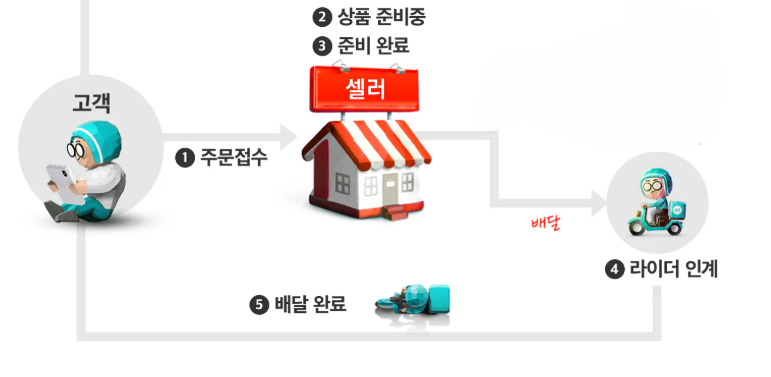

# 5. 배송

Status: Draft
Created time: 2026년 10월 7일 오전 10:10
Last edited time: 2026년 10월 15일 오전 9:55

# 배송 담당 파트

| **담당** | **사용하는 화면** | **주요 업무** | **권한의 범위** |
| --- | --- | --- | --- |
| 배달원 / 라이더 | 라이더앱 | 운행 시작·종료, 배차 응답, 도착·픽업·전달완료, 도움요청 | 본인에게 배정된 배송 수행 및 증빙 등록 |
| 피킹·패킹 점원 | 점원앱 / 배차요청 화면 | 피킹·포장, 포장정보 등록, 배차요청, 인계 확인, 회수품 수령 | 본인 점포 주문·포장·인계 처리 |
| 점포 관리자 | 점포 관리 화면 | 주문 접수 제한, 준비 지연 대응, 분할·추가 배차 요청, 회수품 검수 | 점포 운영 및 상품 처리 |
| 고객센터 / 운영 관리자 | 상담·배송 관제 화면 | 고객 연락, 예외 처리 승인, 환불·재배송, 귀책·비용 결정, 상태 정정 | 승인 범위 내 고객 대응 및 사건 처리 |
| 배송 서버 | 공통 처리 기능 | 후보 탐색, 배정 확정, 상태 검증, 이력 저장, 연동 알림 | 여러 앱이 공유하는 배송 상태의 기준 제공 |
| 주문·결제·재고·정산 담당 | 각 업무 시스템 | 환불, 재고 예약·출고·검수, 수익 확정·입금 | 해당 업무의 최종 처리 및 결과 회신 |

# 배송 비즈니스 로직

1. 로그인 라이더 인증
2. **라이더앱**
3. **배송 생성 및 배차요청**
4. **배차 알림**
5. 배송
6. **배송 완료**
7. 정산
8. 마이페이지(알림, 배송이력, 이벤트)
9. **취소·사고·예외 처리**
10. 고객앱&관리자 연동
11. 실시간 위치/WebSocket

## 1. 로그인

### 1.1 로그인 및 회원가입

- 전화번호 인증
- 본인인증
- 가입정보 입력(아이디, 비밀번호)
- 배달정보입력(거주지-주소창, 배달지역, 배달수단)
- 지역별/수단별 배달료 안내
- (약관동의)

### 1.2 **면허증, 주민등록 번호, 계좌 기입**

- 인증은 안 해도 되고, 고유성으로 중복가입 불가하게만 구현
- (잘못된 입력, 재전송, 중복 가입, 휴대전화번호 변경 처리)
- 가입완료 → 즉시 운행승인
    
    
    
    
    

## 2. 라이더앱 기본화면

### 2.1 지도와 운행 상태

- 카카오맵 지도 or OSRM API
- https://apis.map.kakao.com/web/guide/
- https://developers.kakaomobility.com/guide/
- 현재 위치, 활동 권역, 본인에게 공개 가능한 점포·배차 정보
- 상태는 `운행 종료 / 운행 중·신규배차 허용 / 운행 중·신규배차 중지`로 구분
- 운행 시작 시 본인·교육·면허·보험·계정 제한·위치 권한 자동 확인
- 신규배차를 OFF로 바꾸면 새 제안만 중지
- 앱을 닫거나 네트워크가 끊겨도 수행 중 배송을 자동 취소하지 않는다. 마지막 통신 시각 기록
- 마이페이지    [8. 마이페이지](https://app.notion.com/p/8-3f2f2b9dbcfa8000849ef1cdf274683e?pvs=21)
- 배달리스트 - 배달종류 및 고객 요청사항 기록

### 2.2 배차 방식

- 첫 가입 시 AI추천 배차모드로 배차알림 제공
    - 일반배차모드 - 서버가 공개한 대기 배송 목록에서 라이더가 선택·수락 (대기목록화면 필요)
    - AI추천배차모드 -  위치·수단·거리·수행 중 배송·예상 소요시간을 고려해 후보에게 제안
    - 자동추천모드라도 라이더의 수락 없이 배정 확정으로 처리하지 않는다.
    - 점포의 배차요청 화면과 라이더의 배차모드 설정은 별개 기능으로 관리

### 2.3 운행시간**·권역**

- B마트 배차 가능 시간은 오전 9시부터 당일 24시까지
- 종료시간이 지났더라도 수행 중 배송은 완료·예외 처리할 수 있어야 한다.
- 권역 밖, 위치 권한 해제, GPS 오류, 위치 갱신 지연 확인 및 기록 필요
- B마트에서 일정 거리 내부에 있는 기사만 B마트 배차 알림이 가야 한다.  (권역 밖이면 배차알림x)
- 거리별 배달료 자동측정 및 안내
- 운행시작
    - 운행시작 버튼을 누르면 매장(연동)에서 배차시도 가능 및 배차알림 뜸
    - 신규배차 버튼 ON/OFF 가능 (마트 연동)

## 3. 배차요청 ( 패킹앱 )

https://ceo.baemin.com/guide/10592?one_depth=%EC%A3%BC%EB%AC%B8%EC%A0%91%EC%88%98&two_depth=%EB%B0%B0%EB%AF%BC%EC%A3%BC%EB%AC%B8%EC%A0%91%EC%88%98%20PC (PC 버전 - 관리자 주문 및 배달 접수)

https://ceo.baemin.com/guide/10597?one_depth=%EC%A3%BC%EB%AC%B8%EC%A0%91%EC%88%98&two_depth=%EB%B0%B0%EB%AF%BC%EC%82%AC%EC%9E%A5%EB%8B%98%20%EC%95%B1 (앱 버전 - 관리자 주문 및 배달 접수)

### 3.1 포장점원의 배차요청

- 고객 주문을 점원앱에서 조회하고 피킹·포장을 진행
- 점원이 주문번호·상품·수량·봉투 수·보관 조건을 확인한 뒤 배차요청
- 요청 시 배송번호, 점포, 배송지, 포장 소요시간, 부피·무게·봉투 수, 주류 여부, 예상 배달료 정보 전달
- 패킹시작과 패킹완료와 배차요청은 별도 이력으로 기록
- 패킹 시작 시 패킹소요시간을 입력해 배차 요청 가능. 단 배차요청 시 패킹소요시간을 입력해야 하고
- 피킹, 패킹 준비 중 상태가 표시되며 실제 인계는 포장 검수가 끝난 뒤 허용
- 고객앱 → 주문내역 → 패킹앱 → 포장시작 → 배차요청 → 포장완료 → 인계 (출고대기 - 픽업)
- 기사용 피키패킹 상황 및 출고대기 확인용 사이트 (DB 조회만 하면 되지만 사이트를 별도로 제작해야 함)

- https://m.blog.naver.com/apexjm/222176594019?targetKeyword=%EB%B0%B0%EB%8B%AC%EC%9D%98%EB%AF%BC%EC%A1%B1%EB%B0%B0%EB%8B%AC

### 3.2  **기사 탐색 및 배차 제안**

- 배민앱이랑 관리자랑 배달앱이 연동이 되어야 해서 배민커넥트에만 배차알림을 보냄
- 운행·신규배차 상태, 활동 권역, 위치 최신성, 계정 제한, 수행 중 배송·운반 용량을 서버가 확인 후 기사를 자동으로 추려서 등급별•거리별 배차 요청을 단계별로 보냄
- 1차 배차 알림: 1km 이내 또는 우수등급 라이더
- 2차 배차 알림: 2km 이내 라이더
- 3차 배차 알림: 3km 이내 라이더
- 요청 한 번마다 배차시도번호를 만들고, 특정 라이더에게 보내는 제안마다 제안번호 부여
- 미응답 만료, 거절, 알림 전송 실패는 구분해서 별도로 기록
- 응답 대기 제한시간 1분 (1분 지나면 미응답 만료)
- 기사 배차 반경 3km. 배차요청 재시도는 최대2회 10분 간격으로 자동 요청 처리.
- 규격이 크면 한 주문번호에 기사 추가 배차해서 2명 배차 가능
- 분할배송·회수·재배송은 원주문내역과 연결하되 독립된 배송번호 부여
- 취소된 주문에는 신규 배차를 진행하지 않음.

### 3.3 배차 수락

- 포장점원이 요청을 보내도 기사에게 알림을 보내고 수락을 확정하는 처리는 배송 서버가 담당
- 여러 명이 동시에 수락해도 한 명만 배정하고 완료되면 나머지 라이더에겐 이미 배정되었다는 결과 제공
- 배송번호, 점포, 배송지, 포장 소요시간, 부피·무게·봉투 수, 주류 여부, 예상 배달료를 기사가 확인 가능
- 수락은 관리 시스템 DB 배차이력에 유효로 기록

**배차 이력 예시** 

| **주문번호** | **배송번호** | **배차시도** | **제안번호** | **시각** | **라이더** | **결과** | **사유** |
| --- | --- | --- | --- | --- | --- | --- | --- |
| 2026ABC01 | D01 | A1 | O1 | 10:14 | R01 | 제안 | 최초 요청 |
| 2026ABC01 | D01 | A1 | O1 | 10:15 | R01 | 거절 | 수행 불가 |
| 2026ABC01 | D01 | A2 | O2 | 10:16 | R02 | 제안 | 재시도 |
| 2026ABC01 | D01 | A2 | O2 | 10:16 | R02 | 수락·배정 | 유효한 응답 |

### 3.4 상품 인계

- 배정된 라이더·배송번호·포장번호가 일치하는지 확인
- 배달앱으로 배달기사가 QR을 찍어야 인계 완료로 처리(갯수가 3개면 3개 다 찍어야 인계 완료)
- 라이더앱의 픽업 결과를 PDA앱 또는 PPC 관리자 화면에 반영하고, 인계 시각과 처리 주체 기록
- 중복 스캔, 다른 주문 QR, 다른 라이더, 이미 인계된 포장, QR 인식 실패를 처리

**인계 이력 예시 (한 배송에 포장 3개가 배정된 경우)**

| **주문번호** | **배송번호** | **포장번호** | **담당 라이더** | **인계 상태** | **인계 시각** | 고객수령 |
| --- | --- | --- | --- | --- | --- | --- |
| 2026ABC01 | D01 | P01 | R02 | 인계 완료 | 10:20 | 미완료 |
| 2026ABC01 | D01 | P02 | R02 | 인계 완료 | 10:20 | 미완료 |
| 2026ABC01 | D01 | P03 | R02 | 인계 완료 | 10:21 | 미완료 |

### 3.5 배차 거절 및 재시도

- 관리 시스템 DB 배차이력에 거절로 기록
- 다음 후보 탐색 자동 재요청 또는 운영자 확인 및 수동 재요청 중에 고르기
- 배차요청을 거절한 기사에게 같은 주문번호의 배차요청을 최대2회, 10분 간격으로 재요청 가능
- 수락 이후 배차취소와 배차거절은 다른 사건으로 관리 및 별도 기록

### **3.6 배차 불가·지연**

- 기사 없음, 반복 거절, 응답 만료, 시스템 장애를 구분
- 대기시간이 기준을 넘으면 점포 관리자·고객센터에 안내
- 고객에게 지연 사유와 수정 예상시간을 안내하고, 취소·환불이 필요한 경우 주문 담당과 연결
- 추가할증은 운영자가 승인하거나 미리 정한 예산·조건 안에서 적용(거절횟수, 피크타임 등)
- 새 수행료를 제안하면 금액·정책 버전을 함께 기록
- 주문량·점포 처리능력·라이더 수급이 부족하면 관리자 권한으로 신규 주문을 제한

### 3.7 **추가·분할 배차**

- 주문 1건에 여러 배송을 연결할 수 있도록 설계 및 각 배송의 봉투·상품 수량·담당 라이더를 구분
- 과적 기준은 수단별 무게·부피·봉투 수 및 보냉 요구 고려
- 고객에게 분할배송 여부와 각 배송의 진행 상태를 안내
- 10kg 이상이면 자동 분할 패킹 시스템

## 4. 배차알림

### 4.1 표시 정보

- 고객앱, 패킹앱 DB 연동 필요
- 배달 권역의 B마트 근처 일정 거리 안에 있어야 배차알림 수신 가능 - 위치 기반
- 신규배차 ON 눌러야 수신 가능.
- 구간or한집배달, 배달료, 픽업지, 전달지, 응답 남은 시간(1분) 우선적으로 표시
- 수단 적합성 판단에 필요한 세부조건(봉투 수·부피·무게·주류 여부·특별 운반 조건) 표시
- 개인정보나 포장번호 등은 단계별로 필요한 범위만 공개
- 추천배차 알림과 일반배차 목록 모두 같은 서버 배정 결과를 사용

### 4.2 수락 처리

- (연동) 패킹앱에서 배차완료로 전환된 이후에는 뒤늦게 수락 시 수락 불가 화면
- 수락 성공 이후에만 라이더에게 상세 수행 화면을 제공하고 점원앱을 배정 완료로 전환
- 늦은 수락은 `시간 만료 / 이미 배정 / 주문 취소 / 자격 또는 용량 불충족`으로 구분해 안내

### 4.3 거절**·**미응답

- 사유 입력
- 거절, 시간초과, 알림 실패 구분
- 연속 5회 거절한 기사에게는 신규배차를 꺼달라는 팝업 알림

## 5. 배송 중

### **5.1 배송 화면·길찾기**

- 픽업·전달 위치 지도와 현재 단계의 주소 안내
- 길찾기 버튼 → 상세화면 이동 → 선택한 지도앱으로 점포 또는 고객 주소 경로안내
- 마트로 이동할 때 주문번호, 상품·포장 수량, 준비 상태, 픽업 요청사항 표시
- 가게도착 버튼 누르면 해당 주문건의 QR코드를 찍어야 픽업 완료 버튼 뜸
- 픽업 후 고객의 전달 배송지·상세주소·연락 기능으로 전환
- `가게 도착 → 픽업 완료 → 고객 도착 → 전달 완료` 순서로 상태 변경
- 가게 도착과 픽업 완료 구분, 인계 확인 후 픽업 완료 가능 [3.4 상품 인계](https://app.notion.com/p/3-4-3f7f2b9dbcfa80d49f56e32b7a6aa9a5?pvs=21)
- GPS 위치만으로 픽업·전달 완료 처리 불가

### **5.2 실시간 위치·ETA**

- 배달앱 위치와 도착예상시간(ETA)을 패킹앱·관리자·고객앱에 연동
- 위치 좌표·갱신 시각·정확도 기록
- 점원은 점포 도착예상시간, 고객은 본인 주문의 배송 위치·예상시간 조회
- 다른 고객의 주소나 라이더의 전체 운행경로는 고객앱에 노출하지 않음
- 위치 조회 불가·갱신 지연 시 `위치 확인 중 / 도착예상시간 확인 중` 화면
- 준비 지연·픽업 대기·교통상황·수행 순서에 따라 ETA 갱신
- 기준 시간보다 지연 시 고객에게 사유·수정 예상시간 자동 알림 (기준·재알림 간격 정하기)

### **5.3 여러 건 수행**

- 최대 3개 연속 배차 수락 가능
- 건수 외 수단별 무게·부피·보냉 조건·예상 지연도 확인
- 각 배송의 픽업·전달 순서와 진행 상태를 별도로 관리
- 한집·알뜰배달과 바로·구간배달의 적용 범위 확인
- 하나씩 배달하기 설정은 8.2 설정과 연동

### **5.4 도움요청·배차취소**

- 도움요청 버튼
    - 배차취소, 점포 대기, 상품 이상, 전달 불가, 사고·고장, 상태 정정
    - 지원센터 연결, 배송번호·현재 단계·사유·사진 연동
- 배차취소는 라이더 배정 해제, 주문취소는 고객 주문·결제 취소로 구분
- 픽업 전 배차취소 → 상품은 점포에 남음 → 다른 라이더 재배차
- 픽업 후 배차취소 → 지원센터가 상품 위치·회수·재인계 확인 후 처리
- 진행 중 상품을 다른 라이더에게 임의 인계 불가
- 반복적인 배차취소의 제한 기준 정하기 (9.7 계정 제한 연동)

https://woowabaebaek.oopy.io/41a0d302-e30e-44d3-a984-20495e03719b

### **5.5 배송 중 고객 주문취소**

| **취소 시점** | **공개된 배민커넥트 지급 기준** | **연동 처리** |
| --- | --- | --- |
| 가게 도착 전 | 배달료 미지급 | 제안·배정 해제, 주문·환불 결과 반영 |
| 가게 도착 ·픽업 전 | 바로배달: 취소수수료 지급
구간배달: 픽업비용 지급 | 도착 시각 확인, 점포 상품 처리 |
| 픽업 완료 후 | 지원센터 - 배달료 정상 지급 | 회수·폐기 지시, 지급 근거 기록 |
- 고객 환불과 라이더 지급은 별도로 처리
- 취소와 픽업이 동시에 발생하면 처리 시각과 실제 인계 여부 확인
- 피킹 전 고객 주문취소는 자율
- 픽업 전 고객 주문취소는 고객센터 문의 시 가능
- 배달시작 후 고객 주문취소는 배송 및 회수비 9000원 부담해야 가능
- 배송 중 주문취소https://woowabaebaek.oopy.io/d3bf7411-1200-4513-9161-02077f6b297c

### 6. 배송 완료

### **6.1 전달 완료·연동**

- 라이더가 상품 전달 후 전달완료 버튼 클릭
- 대면 전달 시 고객이 배달 완료 누르면 배달앱 및 피킹앱에 완료 처리
- 대면/비대면 전달 시 사진을 업로드 해야 배송 인정 → 배달 완료 버튼 누를 수 있음
- 전달 방식, 전달 시각, 필수 증빙·인증 확인 후 서버에서 완료 처리
- 고객앱·패킹앱·관리자에 완료 상태 연동 및 고객 알림 전송
- 완료 수익은 중복 클릭 시 한 번만 반영 [**7.2 수익·정산**](https://app.notion.com/p/7-2-3f7f2b9dbcfa80c68f50c71da4649b5e?pvs=21)
- 고객 수령확인은 라이더의 배송 완료와 별도 기록
- 완료 후 미수령·파손 신고 시 기존 완료 이력 유지, 9. 문제발생에 사건 생성

### **6.2 비대면 전달·사진**

- 고객이 요청하거나 지원센터가 승인한 장소에 전달
- 전달 사진·보관 장소·촬영 시각 등록 (B마트 사진 필수 범위·예외 확인 필요)
- 사진 업로드 성공 → 전달완료 처리 → 고객에게 사진·완료 알림 전송
- 업로드 실패 시 재시도 또는 지원센터 승인 대체 증빙 등록
- 사진에 다른 고객·신분증·출입 비밀번호가 노출되지 않도록 안내
- 고객 부재·출입 불가 등은  [9. 문제발생 (관리자 및 운영)](https://app.notion.com/p/9-3f2f2b9dbcfa8073871edcac802c94f9?pvs=21)

### **6.3 주류 배송**

- 주류 포함 시 성인 확인·서명 화면 표시
- 라이더가 수령인 신분증 확인, 수령인이 직접 서명
- 확인 결과·확인자·시각·서명 정보 기록 및 고객센터 연동
- 신분증 사진·번호 전체를 기본 저장하지 않음 (서명 보관기간·열람 권한 정하기)
- 신분증 미소지·제시 거부·미성년 의심 → 전달 보류 → 지원센터 문의
- 문 앞 보관·라이더 대리 서명 불가
- 주류 전달 불가 시 전체 회수 및 2시간 보관 이후 자동 환불 (2번 연락)
- https://woowabaebaek.oopy.io/313a6ba6-1251-411f-ae73-9c59a277548e

### **6.4 완료 누락·분할배송**

- 전달완료 누락 시 라이더 재확인 알림 → 미해결 시 관리자 확인
- 결제완료 후 컴플레인 없으면 5시간 후 자동 전달 완료 처리 됨 → 고객앱, 관리자앱, 패킹앱도 완료처리
- 시간 경과만으로 실제 전달·주류 인증·수익까지 자동 확정하지 않음
- 관리자 정정 시 확인 근거·처리자·시각 기록
- 분할배송은 각 배송번호별 완료, 남은 배송이 있으면 고객에게 부분 전달로 표시
- 주문 전체 완료는 모든 배송 또는 미전달 상품의 환불·취소 처리 결과와 연동
- 재배송은 원배송과 연결하되 별도 완료 이력으로 기록

## 7. 배달료

### **7.1 배달 수수료·할증**

- 수단·지역·거리별 수행료 및 장거리 할증 정하기
    - 수단별(자동차, 오토바이, 자전거, 도보 등)
    - 지역별
    - 거리별(ex. 600m 기준 3000원)
    - 픽업지까지 이동(ex. 엘레베이터 없는 15층 500원 추가)
    - 장거리 할증 (ex. 2km 3,900원 / 3km 4,900원 / 4km 5,900원 / 5km 6,900원 )
- 고객 상품 결제액·배송비, 라이더 수행료, 점포 부담 비용은 구분
- 제안·수락 당시 금액과 적용 조건 기록, 이후 보상·조정은 별도 내역
- 회수료·재배송료·취소수수료는 원배송 수행료와 별도 계산

### **7.2 수익·정산**

- 배달 완료 확정 시 수익 업데이트, 계좌 입금 상태와 구분 (확정 시점 정하기)
- 배달 수행일로부터 3영업일 뒤 정산, 최대 주 5회 지급 (주말·공휴일 제외)
- 미션·추가 지원금 등은 항목별 지급일 적용
- `예상 / 확정 대기 / 지급 확정 / 지급중 / 지급 완료 / 지급 실패 / 조정`으로 관리
- 정산내역에 수행료·보상·공제·조정 사유·지급 예정일·입금 결과 표시
- 계좌 오류·입금 실패 시 재지급 처리, 사건 관련 미확정 항목은 사유 표시
- 고객 환불만으로 라이더 수행료를 자동 취소하지 않음
- https://join.baeminconnect.com/

### **7.3 보너스·프로모션**

- 배달 고수클럽·배차 보너스·미션·친구초대 등 조회
- 기존 조사: 고수클럽 월 최대 15만원 추가 보너스
- 대상·기간·건수 집계·지급일 기록
- 취소·분할배송·재배송·회수가 실적에 포함되는지 확인
- 추가 보상은 승인 사유·금액·지급일 기록, 중복 지급 방지

https://blog.naver.com/PostView.naver?blogId=baeminconnect&logNo=223735855282&categoryNo=6&parentCategoryNo=&from=thumbnailList

## 8. 마이페이지

### **8.1 조회 기능**

- 오늘배달내역 - 완료건수, 진행 중 건수, 오늘수입
- 라이더 개인 정보 - 개인 정보, 배송 수단, 배달 지역
- 친구초대
- 이벤트 및 공지사항
- 정산내역  - 수행료·보상·공제·지급 결과 [7. 배달료 ](https://app.notion.com/p/7-3f2f2b9dbcfa8032a881e910a38cc212?pvs=21)

- 배달현황 - 기간별 완료·취소·재배송·회수 내역

- 운행시간
- 오늘의 기록
- 면세서 발급
- 설정

### **8.2 설정**

- 배차방식 선택·변경
    - 일반배차모드 - 대기 중인 배달 건 선택 후 수락 ( 배차요청 대기목록화면 필요)
    - AI추천배차모드 - 자동으로 신규배달 알림이 뜸
- 하나씩 배달하기 ON → 현재 배송 완료 전 신규배차 제한, 관리자에게 진행 상태는 계속 표시
- 바로·구간배달 선택 가능
- 길찾기 기본 지도 선택·변경 - 네이버지도, 카카오맵, 애플맵 등 기기 지원에 맞춰 제공
- 알림 ON/OFF와 신규배차 ON/OFF는 구분
- 푸시 OFF여도 수행 중 배송의 취소·사고·정정은 앱에서 조회 가능

### **8.3 내 정보 변경**

- 전화번호·계좌 변경 시 본인 재확인
- 배달수단 변경 시 필요한 면허·일련번호 인증·보험 확인 후 승인 및 변경사항 적용
- 배송 중 수단 변경 불가
- 변경 전 정보로 수행한 배송·정산 이력 유지
- 탈퇴·활동 중단 시 수행 중 배송·미지급 정산·미해결 사건 처리 기준 정하기

## 9. 문제발생 (관리자 및 운영)

### **9.1 도움요청·고객 연락**

- 도움요청 버튼 - 배민 지원센터 실시간 상담 연결
- 고객·라이더·점포 문의를 사건번호로 연결
- 사건에 주문·배송·포장번호, 신고자·시각·사유·증빙·상품 위치 기록
- 고객 연락 시 안심번호 사용 (5시간 유효)
- 전화·알림·메시지의
- 시도 시각과 결과 기록
- 점포 관리자: 현장·상품 확인 / 고객센터: 고객 대응·예외 승인·비용 결정
- 고객앱·카카오 알림 연동, 전송 실패 시 재시도

### **9.2 고객 측 사유**

- **고객 부재·공동현관 출입 불가**
    - 고객 요청 확인·연락 시도 → 전달 불가 시 도움요청·사유 입력
    - 라이더의 연락 횟수·대기시간 정하기 (공식 안내의 센터 연락 2회 이상과 구분)
    - 승인 장소에 비대면 전달 후 사진·보관 위치·승인 기록 등록 및 고객 알림
    - 공동현관, 경비실 등에 배송 후 ‘알리기 버튼’ 고객에게 사진 업로드 및 상황 전달
    - 대학교 건물 입구 같은 곳은 도움요청 - 지원센터에서 고객에게 상황 알림
    - 고객센터 확인·승인 후 대체 장소 전달 또는 회수·취소 결정
    - 주류·보관조건 유지 불가 상품은 일반 비대면 절차와 구분

- **주소 불일치**
    - 고객 주소 오입력, 라이더 오배송, 지도·시스템 오류 구분
    - 원주소·변경주소·권역·추가 거리·현재 배송 단계 확인
    - 기존 기사 추가 이동 또는 회수·새 기사 재배송 여부 승인
    - 귀책에 따른 추가 운행료·고객 비용·부담 주체 기록
    - 배달 도중 주소 변경 시 200m 이상 차이는 추가요금을 B마트 부담하고 변경 주소로 배송
    - 배달완료면 새로운 기사 배차 (추가요금을 B마트가 감당)
- **고객 요청 시간 변경**
    - 준비·배차·픽업 단계와 상품 보관 가능성 확인 후 허용 여부 결정
    - 변경 불가 시 정상 배송 또는 취소 안내
- **보상배차(추가보상) 요청**
    - 지원센터에 엘리베이터 고장·주소 변경·장시간 대기 등 사유·사진 등록
    - 승인자·실제 수행·추가 금액·지급일 기록
    - 지원센터가 확인 후 엘레베이터 고장 15층부터 5층 단위로 500원 추가 배달료 지급
    - 보상금 추가와 다른 라이더 추가 배차는 별도 처리
- **위험한 배송지·위협 상황**
    - 안전한 곳으로 이동 → 안전한 전달 위치 협의 또는 지원센터 문의
    - 전달 불가 시 지원 센터가 중단·취소·고객 환불 등 결정
    - 원배송 보상·추가 회수료·비용 부담 주체 별도 결정 논의 필요
    - 귀책사유가 고객에게 있다고 판단 시 거리만큼 배달료 지급
    - https://woowabaebaek.oopy.io/d3bf7411-1200-4513-9161-02077f6b297c
- **기타**
    - 직접 입력, 증빙 등록, 고객센터 승인 결과 기록

### **9.3 B마트 및 배달 측 사유**

- 고객 대응(환불·재배송), 상품 처리(회수·폐기), 귀책·비용·라이더 지급은 각각 기록
- 귀책 조사 중에도 가능한 고객 대응 진행, 비용 판단은 별도 확정

| **귀책** | **고객 대응** | **배달료·비용 처리** |
| --- | --- | --- |
| 라이더 운반 과실 | 환불·부분 환불·재배송 결정 | 수행료·상품 손해·추가 운행료를 약관·판정에 따라 각각 처리 |
| B마트 피킹·포장·품질 문제 | 환불·부분 환불·재배송 결정 | 정상 수행료와 추가 운행 비용 검토, 사업자 부담 기록 |
| 복합 원인·판단 불가 | 증빙 확인 및 가능한 고객 대응 | 원인 확인 후 부담 주체·금액 확정 |
- **배송 중 파손·포장불량 발견**
    - 픽업 전: 점원에게 알리고 인계 보류 → 재포장·대체·환불 결정
    - 픽업 후: 도움요청 → 사진·시각·상품 위치 등록 → 회수·폐기·재배송 승인
    - 일부 상품만 이상이면 해당 상품·수량의 부분 처리 논의 필요 (회수or폐기/재배송or취소환불)
    - 귀책이 포장불량이면 배달료 정상 지급
    - 라이더 귀책이면 배달료 미지급
- **완료 후 파손·누락·제품 품질 문제**
    - 고객 신고·사진과 피킹·포장·인계·배송 이력 확인 → 패킹측vs배달측 귀책여부 판단
    - 재고·고객 동의 확인 후 환불·교환·재배송, 필요 시 회수 배차
    - 쿠폰 등 추가 보상은 별도 승인, 고객 환불과 라이더 공제를 동일하게 처리하지 않음
- **전달사항 미준수·오픽업·오배송**
    - 요청사항·주문번호·포장·주소·전달사진 직접 확인 후 고객센터가 대응
    - 포장 라벨 오류·주소 오입력·라이더 실수 구분
    - 라이더 귀책이면 배달료 미지급
    - 회수 가능성·상품 상태 확인 후 환불·재배송 결정
    - 원기사 추가 이동·다른 기사 회수료·재배송료 각각 기록 (미지급 여부 확인 필요)
    - 기사 평가에는 확인된 사건·소명 결과 반영, 후기로만 자동 제재하지 않음
- **교통사고·운송수단 고장**
    - 안전 확보·필요한 구조·진료 → 지원센터 연락· 개인이 해당 보험 접수
    - 배송 지속 가능 여부, 상품 위치·손상·보관 상태 확인
    - 고객에게 지연 안내 후 환불·재배송·회수·폐기 결정
    - 임의 폐기·대리 전달 불가, 승인 후 재배정·인계 기록
    - 등록 수단·차량·보험과 실제 운행 불일치 시 보험 적용 여부 확인·계정 조치
- **과적**
    - 무게·부피·봉투 수·보냉 조건·수단별 적재 가능성 확인
    - 인계 보류 → 점포 재포장·추가 라이더 요청 [3.7 **추가·분할 배차**](https://app.notion.com/p/3-7-3f7f2b9dbcfa80d49ec4c8940164c42c?pvs=21)
    - 일부 인계된 경우 가져간 포장과 남은 포장 구분
    - 기사 1명 배차 건에 10kg 이상 배차 시 기사가 분리요구 가능 → 마트 재포장 및 추가배차 접수
    - 아래는 배민스토어 묶음형 참고 기준이며 B마트 기준과 구분
- https://robalife.tistory.com/20
    
    https://ceo.baemin.com/guide/12211?one_depth=%EC%84%9C%EB%B9%84%EC%8A%A4%20%EC%8B%9C%EC%9E%91&two_depth=%EB%B0%B0%EB%AF%BC%EC%8A%A4%ED%86%A0%EC%96%B4%20%EB%AC%B6%EC%9D%8C%ED%98%95
    

| **구분** | **가로+세로** | **봉투 용량** | **추가 라이더 요청 기준** |
| --- | --- | --- | --- |
| 소 | 80cm | 15L | 5개 초과 |
| 중 | 90cm | 25L | 3개 초과 |
| 대 | 105cm | 40L | 2개 초과 |
| 초대형 | 120cm | 50L | 1개 초과 |
- **배달 상태 잘못 변경**
    - 도움요청 → 실제 수행 확인 → 관리자 정정
    - 변경 전후 상태·사유·처리자·시각 기록, 고객에게 정정 알림
    - 잘못 반영된 수익·재고·결제는 실제 수행 확인 후 별도 조정

### **9.4 마트 관리자 관련 문제**

- 배정되지 않은 기사 QR 픽업 시도·중복 인계 등은 [3.4 상품 인계](https://app.notion.com/p/5-3f2f2b9dbcfa80359b9afe2e4a467a21?pvs=21)에서 차단
- 배달앱·패킹앱·관리자에 인계 불가 사유와 시도 내역 연동
- 정상 재배정 시 이전 기사 권한 해제, 새 기사만 인계 가능
- 비지정 기사 접근 시도 차단 내역 기록
- 단순 스캔 실수와 고의적인 접근 시도 구분

### **9.5 반품·교환·회수·재고**

- 고객앱·고객센터 접수 → 사유·상품·수량·사진 확인 → 환불·교환·재배송 및 회수 여부 결정
- 원주문·원배송·사건과 연결된 회수번호·배송번호 생성
- 원기사 회수 또는 별도 기사 배정 (실제 수행 주체·회수료 기준 확인 필요)
- 회수 기사에게 대상 상품·수량·고객 위치·반납 점포·보수 제공
- `고객 수거 → 점포 반납 → 점원 수령 확인 → 검수 → 재입고 또는 폐기`로 관리
- 회수 당담 기사가 마트 관리자(점원)한테 직접 전달 후 점원이 회수 완료 처리
- 고객 수거·점포 수령·검수·환불 완료는 별도 상태로 기록
- 부분 회수, 고객 부재·거부, 수량 불일치, 회수 중 파손, 점포 수령 불가 처리
- 재배송은 별도 배송번호로 상품·포장·라이더·비용 연결
- 같은 상품·수량의 환불·재배송 중복 처리 방지
- 환불액은 실제 결제 배분액·쿠폰·할인·배송비 기준으로 계산
- 부분 환불 시 전체 취소·재결제가 필요한지는 결제수단에 따라 결정
- https://sk956.tistory.com/636

**재고 처리 (점포 판매가능 재고 기준, 출고 시 차감하는 설계 예시)**

| **상황** | **재고·결제 처리** |
| --- | --- |
| 출고 전 주문취소 | 예약 재고 해제, 결제 취소·환불 |
| 정상 출고 | 출고 수량 1회 차감, 예약 종료 |
| 출고 후 완전 파손 | 이미 출고 차감했으면 추가 차감 없음, 파손·손실 별도 기록 |
| 새 상품 재배송 | 새로 출고한 수량 차감 |
| 재배송 없이 환불 | 환불만으로 재고 증감하지 않음 |
| 회수품 점포 수령 | 검수 대기, 바로 판매가능 재고에 더하지 않음 |
| 검수 후 판매 가능 | 승인 수량 재입고 |
| 검수 후 불량·폐기 | 판매가능 재고 복구 없음, 폐기 수량 기록 |
| 동일 상품 재포장 후 재전달 | 새 상품 출고가 없으면 중복 차감 없음 |
- 예시: 재고 10개 → 1개 출고 후 9개 → 배송 중 파손돼도 9개 → 새 상품 재배송 시 8개
- 포장만 불량이어도 회수·검수·보관 조건 확인 후 재입고 가능
- 주문 시 이미 수량을 차감하는 방식이면 출고 시 다시 차감하지 않도록 재고 파트와 합의 필요

### **9.6 라이더 계정 제한**

- 고객 후기·신고, 배송·인계·면허·보험 이력 확인 후 보상·제재·제한 여부 결정
- `정상 / 신규배차 제한 / 일시 중지 / 계약 종료` 구분, 사유·기간·통지·소명 결과 기록
- 계정 공유·무단 대리 수행·GPS 조작·자동 배차수락 앱 사용 여부 확인
- 수단 불일치는 등록정보·현장 확인·신고 등으로 확인 (속도만으로 무면허 확정 불가)
- 위치 조작 의심과 GPS 오차·통신 지연 구분
- 제한 시 라이더앱의 신규배차·수락·픽업 권한과 패킹앱의 인계 가능 여부 연동
- 수행 중 상품은 안전한 전달·회수·재배정 처리, 기존 지급액은 별도 정산
- 기사 등급의 관리자 노출·후기 반영·보상·패널티 기준 정하기 (실제 정책 확인 필요)
- 고수클럽 등 보상 등급과 민원·제재 이력은 구분

### **9.7 사건 종료·연동 예외**

- 고객 대응·상품 회수·검수·환불·추가 운행·정산 결과 확인 후 사건 종료
- 고객 대응 완료와 사건 전체 종료 구분, 비용 변경 시 승인자·근거·금액 기록
- 상태 변경은 서버 확정 결과를 기준으로 앱에 반영
- 중복 요청은 한 번만 처리 (수락·인계는 3~4번, 완료·수익은 6~7번 연동)
- 환불 요청과 실제 환불 성공 구분, 실패·지연 결과 안내
- 사진·지도·통신·서버 장애 시 재시도 또는 관리자 대체 확인
- 앱 재접속 시 최신 상태 조회, 오래된 요청의 유효성 재확인
- 취소와 수락·픽업, 완료와 사고 신고가 동시에 발생하는 경우 처리
- 점포 휴점·품절·라이더 이탈·봉투 누락·연락처 오류·중복 환불 요청도 고려
- 원주문·원배송 이력은 유지, 수정 사유와 후속 처리 기록

## 10. 고객앱 및 관리자앱 연동

### **10.1 관리자 화면·상태 관리**

**관리자 페이지 DB 예시**

**실시간 배송 현황**

**포장 인계 현황**

- 주문번호로 배송·배차·포장·상담·재고·정산 이력 연결
- 상태는 업무별로 분리, 변경 전후 값·처리자·시각·사유 기록

| **구분** | **상태 예시** |
| --- | --- |
| 주문·결제 | 접수, 처리중, 부분 취소, 취소, 환불 요청·완료 |
| 피킹·포장 | 피킹중, 포장중, 준비완료, 인계 완료 |
| 배송 | 점포 이동, 도착, 픽업, 고객 이동, 전달 완료, 중단 |
| 사건 | 접수, 확인중, 조치 결정, 처리중, 종료 |
| 회수 상품 | 회수중, 점포 수령, 검수, 재입고, 폐기 |
| 정산 | 미확정, 지급 대기, 지급 완료, 조정 |
- 파손·포장불량·오배송은 사건 유형, 지연은 배송 단계와 함께 표시
- 배송 완료 후 사고 신고·환불이 발생해도 기존 완료 이력 유지

**실시간 주문 현황**

| **주문번호** | **배송 상태** | **기사** | **예정시간 / 완료시각** | **사건** |
| --- | --- | --- | --- | --- |
| 9001 | 배송 중 | 김인수 | 15:30~15:40 | 없음 |
| 9002 | 상품 준비 중 | 배정중 | 15:40~15:50 | 없음 |
| 9003 | 배송 중·지연 | 이준호 | 수정 시간 확인중 | 교통 지연 |
| 9004 | 배송 완료 | 박서연 | 15:20 완료 | 파손 신고 |

### 10.2 주문배송 연동

- 주문·피킹·포장·배차·픽업·전달 상태 및 ETA 연동
- 배송 상태와 취소·환불 진행 상태 구분
- 배송 가능 주소·점포·영업시간·주문 제한 연동
- 주소·전달사항 변경 시 가능 단계·승인 확인 후 라이더에게 재안내
- 사진·분할배송·미수령 신고·환불·재배송·회수 진행 조회

### 10.3 예약 배달

- 요일, 시간대 별 평균 주문 수와 패킹점원수와 평균 라이더 수급 고려
- 즉시배달 수요, 지역, 거리, 날씨, 피킹·패킹 능력, 여유 용량 감안해서 시간대별 예약 정원 제한
- 배달시작 알림 및 일정 거리 안에 도착하면 곧 도착합니다 알림 자동 전송됨
- 예약 주문·재고 예약·결제·준비·배차 시점을 별도로 관리
- 예상 포장 준비 시간에 맞춰 점원에게 알림 → 준비 진행 → 거리 및 이동 시간 계산 → 자동배차요청
- 초기에는 시간대별 정원·수동 설정으로 구현 가능, 수요 예측 알고리즘은 추가 기능
- 예약 변경·취소·품절·휴점·기사 부족·기상 악화 시 재안내·대체 시간·환불 처리

### 10.4 배달 가능 지역 안내

- 고객은 고객앱의 실제 배송지로 주문 가능 여부 확인
- 라이더 활동 권역과 고객의 B마트 주문 가능 지역은 구분
- 점포별 배송 권역·영업시간·일시 주문 제한 조회
- 노션·블로그는 안내용, 실제 주문 가능 여부는 서버 최신 설정으로 판단

## * 출처

[‣](https://app.notion.com/p/1cfc763a98db8049b0e7f95acaea75c3?pvs=21)  배달 가능 지역 안내

https://blog.naver.com/baeminconnect/222594414779

https://blog.naver.com/PostList.naver?blogId=baeminconnect&from=postList&categoryNo=6  (⭐배민커넥트 서비스 소개 )

- [우아한 배달 백과사전](https://woowabaebaek.oopy.io/)
- [배민커넥트 공식 가입·정산 안내](https://join.baeminconnect.com/)
- [배달 중 난처한 상황: 고객 부재·취소·포장불량](https://woowabaebaek.oopy.io/d3bf7411-1200-4513-9161-02077f6b297c)
- [배달 정책: 상태·운송수단·주류·부정행위](https://woowabaebaek.oopy.io/313a6ba6-1251-411f-ae73-9c59a277548e)
- [사고 대응·보험 접수](https://woowabaebaek.oopy.io/74414f3a-55a8-4720-9c3a-84ca6a70e659)
- [배민스토어 QR 픽업 안내](https://woowabaebaek.oopy.io/d40e1f32-9b27-4881-995b-229da269166d)
- [오픽업·오배송·누락·훼손 대응](https://woowabaebaek.oopy.io/10f9b6bd-c34a-4491-8fd2-cbf2caeb6723)
- [배민스토어 주문·자동 완료 안내](https://ceo.baemin.com/guide/10577)
- [배민스토어 체적·추가배차 안내](https://ceo.baemin.com/guide/12211)
- [일반 배민배달 운영·예약 관련 안내](https://ceo.baemin.com/guide/12699)
- [배민스토어 서비스 안내](https://ceo.baemin.com/guide/baemin-store?one_depth=%EC%84%9C%EB%B9%84%EC%8A%A4%20%EC%8B%9C%EC%9E%91&two_depth=%EB%B0%B0%EB%AF%BC%EC%8A%A4%ED%86%A0%EC%96%B4%20%EA%B8%B0%EB%B3%B8%ED%98%95)
- [B마트 배달 후기](https://blog.naver.com/momorua/223487217799)
- [B마트 배달 후기 — 2020년](https://robalife.tistory.com/10)
- [추가 보상 후기 — 2020년](https://robalife.tistory.com/20)
- [B마트 환불 후기 — 2024년](https://sk956.tistory.com/636)
- [정산일 후기](https://pigcat22.tistory.com/entry/%EC%9D%BC%EC%83%81story-%EB%B0%B0%EB%AF%BC%EC%BB%A4%EB%84%A5%ED%8A%B8-%EB%B0%B0%EB%AF%BC%EC%BB%A4%EB%84%A5%ED%8A%B8-%EC%A0%95%EC%82%B0%EC%9D%BC-%EC%97%90-%EA%B4%80%ED%95%98%EC%97%AC#google_vignette)