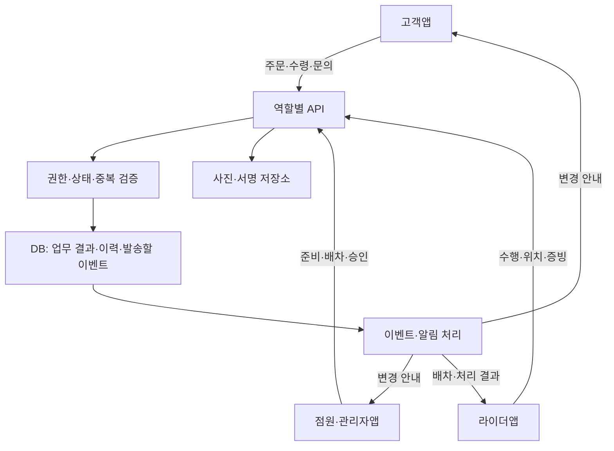
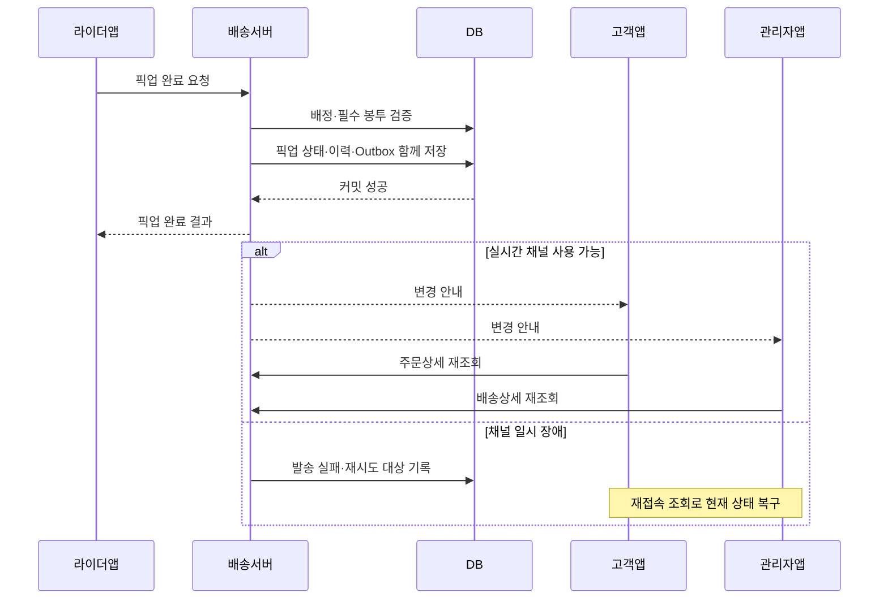

# B마트 고객앱·관리자앱 연동 및 DB 설계

작성 목적: 최종 비즈니스 로직을 앱 연동·데이터·API·예외 처리로 연결하기  
설계 기준: Java / Spring Boot, 관계형 DB(MySQL), 역할별 앱

**각 앱은 서버 API로 업무를 요청하고, 서버가 권한·현재 상태를 확인해 DB에 결과를 저장한다. 고객앱·관리자앱은 그 결과를 각자의 화면에 맞게 조회한다. 상태 변경 알림은 저장이 확정된 뒤 전달한다.**

예를 들어 라이더가 픽업을 완료하면, 서버가 해당 기사와 봉투 인계를 확인하고 픽업 상태를 저장한다. 이후 고객은 ‘배송 중’을 보고, 점원은 ‘인계 완료’를 보며, 관리자는 기사·인계시각·예상시간을 확인한다. 하나의 업무 결과를 역할에 맞게 보여주는 것이 연동의 기본이다.


## 목차

| 먼저 궁금한 것 | 읽을 부분 |
| --- | --- |
| 앱들이 어떻게 함께 움직이는지 | 1~4. 전체 구조·식별번호·고객·관리자 연동 |
| 상태를 어떻게 나눠야 하는지 | 5. 상태와 완료 기준 |
| DB에 무엇을 저장해야 하는지 | 6. 테이블과 관계 |
| 프론트와 백엔드가 무엇을 주고받는지 | 7. API·실시간 알림 |
| 동시에 누르거나 통신이 끊기면 어떻게 하는지 | 8. 트랜잭션·중복·복구 |
| 실제 주문에 적용하면 어떻게 되는지 | 9. 정상·분할·파손·취소 예시 |
| 팀에서 무엇을 먼저 합의해야 하는지 | 10~11. 구현 순서·결정사항 |

## 1. 전체 연동 구조

### 1.1 화면과 업무 담당을 구분하기

앱은 사용자가 조작하는 화면이다. 업무 규칙은 서버가 처리하고, DB는 그 결과와 이력을 보관한다.

| 화면 / 담당 | 요청하는 업무 | 서버가 검증·처리할 내용 |
| --- | --- | --- |
| 고객앱 | 주문 조회, 수령확인, 문의·반품, 주소 변경 요청 | 본인 주문 여부, 변경 가능 단계, 고객에게 공개할 범위 |
| 라이더앱 | 제안 수락, 도착·픽업·전달, 위치 전송 | 현재 배정, 자격·용량, 포장 일치, 필수 증빙 |
| 피킹·패킹앱 | 준비 시작·완료, 배차요청, 인계·회수품 수령 | 담당 점포, 상품·포장 준비, 해당 배송과 포장의 관계 |
| 점포 관리자앱 | 주문 제한, 분할 요청, 점포 운영·검수 | 점포 권한, 처리 중 주문, 상품·재고 처리 기준 |
| 고객센터·운영 관리자앱 | 사건 대응, 환불·재배송 승인, 상태 정정 | 사건·증빙·승인 권한, 변경 영향, 비용 결정 |
| 주문·결제·재고·정산 담당 | 해당 업무의 최종 처리 | 각 업무의 기준 데이터와 실행 결과 |

관리자앱 하나에 여러 메뉴를 만들더라도 **점포 관리자와 고객센터의 권한은 구분**한다.



### 1.2 데이터의 변경 책임

‘주문·배송·결제가 연동된다’는 말은 모든 담당자가 모든 데이터를 마음대로 수정한다는 뜻이 아니다. **업무별로 변경 책임자를 정하고, 필요한 요청과 결과를 연결한다.**

| 업무 데이터 | 최종 변경 책임 | 다른 업무와 연결하는 방법 |
| --- | --- | --- |
| 주문·주문상품·고객 결제액 | 주문·결제 담당 | 배송에 확정 주문·상품·주소 전달 |
| 피킹·포장·봉투 구성 | 재고·점원 담당 | 배송에 준비 상태와 포장번호 전달 |
| 배차·라이더 배정·배송 수행 | 배송 담당 | 주문·관제에 수행 결과 전달 |
| 환불 실행·성공 여부 | 결제 담당 | 운영의 환불 승인 접수, 실행 결과 회신 |
| 재고 예약·출고·검수·재입고 | 재고 담당 | 인계·회수·검수 결과로 처리 |
| 라이더 보수·입금 | 정산 담당 | 수행·취소·귀책 결정·추가 보상 결과 반영 |
| 사건·운영 결정 | 고객센터·운영 담당 | 관련 업무에 실행 요청, 결과를 모아 사건 종료 |

**관리자 화면에서 환불을 승인하면 결제 업무에 환불을 요청한다. 실제 결제 취소가 성공해야 ‘환불 완료’가 된다.** 이 구분은 회수·재입고·입금에도 똑같이 적용한다.

### 1.3 하나의 서버와 MSA에서 달라지는 점

아래 DB 설명은 하나의 Spring Boot 서버 안에 주문·배송·운영 모듈이 있고, MySQL에서 데이터를 연결하는 구성을 기본 예시로 삼는다.

| 구성 | 데이터 연결 | 한 번에 묶어 저장할 수 있는 범위 |
| --- | --- | --- |
| 한 서버·한 DB | 같은 DB의 FK·조회·서비스 호출 | 같은 DB 트랜잭션 안의 변경 |
| 여러 서버·업무별 DB(MSA) | API·이벤트, 상대 업무의 식별번호 | 각 서비스의 자기 DB 안의 변경 |

- MSA에서는 다른 서비스의 테이블을 직접 수정하지 않는다.
- 서로 다른 DB 사이의 식별번호는 논리적인 연결이며, 이 문서의 FK를 그대로 만들 수 있는 것은 아니다.
- 배송 완료 저장과 환불·재고·정산이 모든 서버에서 동시에 완료될 것이라고 가정하지 않는다. 요청·처리중·성공·실패를 추적한다.
- 서비스별 장애 복구와 보상 작업은 8번의 이력·이벤트·재시도 구조를 사용한다.

## 2. 앱을 연결하는 공통 식별번호

### 2.1 주문번호만으로 부족한 이유

한 주문이 기사 두 명에게 나뉘거나, 다시 배송되거나, 회수될 수 있다. 이때 주문번호만 같다고 모두 같은 배송으로 처리하면 누가 어떤 상품을 가져갔는지 구분할 수 없다.

| 번호 | 의미 | 예시 |
| --- | --- | --- |
| `order_id` | 고객의 구매 1건 | 주문 O100 |
| `order_item_id` | 주문에 포함된 상품 행 | 우유 2개, 식빵 1개를 각각 구분 |
| `delivery_id` | 기사에게 맡기는 배송 작업 1건 | D100: 원배송 / D101: 추가 분할배송 |
| `delivery_item_id` | 특정 배송이 운반할 상품·수량 | D100의 우유 1개 |
| `package_id` | 실제 봉투·박스 1개 | P100, P101, P102 |
| `attempt_id` | 배차를 시도한 회차 | A1, A2 |
| `offer_id` | 특정 기사에게 보낸 제안 | A1에서 R1에게 보낸 F1 |
| `assignment_id` | 수락 후 확정된 배정 | 기사 교체 전후 배정을 구분 |
| `incident_id` | 파손·오배송 등 사건 | I100 |
| `return_case_id` | 상품을 회수·검수하는 업무 | RC100 |
| `earning_id` | 라이더에게 지급·조정할 보수 항목 | E100 |

DB의 `id`는 PK(각 행을 식별하는 기본키), 다른 행의 `id`를 연결하는 컬럼은 FK(외래키)라고 부른다. 화면용 주문번호·배송번호는 별도 `public_number`로 관리해도 된다. 예시는 읽기 쉽게 문자열을 사용했다.

### 2.2 관계를 먼저 정하기

| 관계 | 기본 기준 |
| --- | --- |
| 주문 → 배송 | 1:N. 분할·재배송·회수마다 배송 추가 |
| 주문 → 주문상품 | 1:N |
| 배송 → 운반 상품 | 1:N. 어느 상품을 몇 개 운반하는지 기록 |
| 주문 → 포장 | 1:N. 봉투·박스별 번호 |
| 배송 ↔ 포장 | 연결 테이블 사용. 해당 배송의 픽업 대상 지정 |
| 배송 → 배차시도·제안 | 여러 회차·여러 기사 제안 가능 |
| 배송 → 배정 이력 | 여러 이력 중 현재 유효한 배정은 최대 1개 |
| 배송 → 완료 증빙·상태 이력 | 1:N |
| 주문·배송 → 사건 | 여러 사건 연결 가능 |

한 라이더가 맡은 D100 안의 봉투 3개와, 같은 주문의 D100·D101을 서로 다른 라이더가 맡는 경우는 다르다. **분할 여부는 배송 단위로, 빠진 봉투 여부는 포장 단위로 확인한다.**

## 3. 고객앱과 연동

### 3.1 정상 주문의 흐름

| 단계 | 서버 처리 | 고객앱 표시 | 점원·관리자에게 보일 내용 |
| --- | --- | --- | --- |
| 주문·결제 확인 | 확정 주문·주소·상품 생성, 재고 예약 | 주문 접수 | 새 주문·점포 처리 대상 |
| 피킹·포장 시작 | 준비 상태와 예상 완료시각 저장 | 상품 준비 중 | 준비 담당·진행 상태 |
| 점원의 배차요청 | 배송·포장정보 확인, 배차시도 시작 | 준비 중 또는 기사 배정 중 | 제안 회차·대기시간 |
| 라이더 수락 | 제안 검증·현재 배정 확정 | 준비 중 / 기사 배정 완료 | 기사·차량·도착 ETA |
| 봉투 인계·픽업 | 필요한 포장 인계 검증, 픽업 저장 | 배송 중 | 인계 완료·시각·기사 |
| 고객 배송지 이동 | 위치·ETA 갱신 | 배송 위치·도착예상시간 | 지연·수행 경로의 필요한 정보 |
| 상품 전달 신고 | 전달 방식·증빙·인증 저장 | 정책에 따라 수령확인 요청 | 전달 신고·필수 확인 상태 |
| 완료 조건 충족 | 배송 완료 확정·이력·이벤트 저장 | 배송 완료 | 확정 근거·완료시각·보수 처리 상태 |

원문 3.1은 **포장 시작부터 배차요청을 허용**한다. 따라서 포장 상태와 배차 상태는 독립적이다. 기사 배정만 됐는데 상품이 준비됐거나 배송 중이라고 표시하지 않는다.

### 3.2 고객 화면에 필요한 데이터

주문상세를 열 때 고객용 조회 API가 여러 업무의 결과를 묶어 반환한다. 한 서버에서는 조회용 서비스로 묶고, MSA에서는 화면용 집계 API를 둔다.

| 정보 | 전달할 내용 | 기준 데이터 |
| --- | --- | --- |
| 주문·상품 | 주문번호, 상품명·수량, 실제 결제 내역 | `orders`, `order_items` |
| 배송 진행 | 준비 상태, 각 배송 단계, 분할 여부 | 준비 데이터, `deliveries` |
| 지도·ETA | 본인 배송에 공개 가능한 위치, 시간 구간, 갱신시각 | 위치·ETA 데이터 |
| 전달 증빙 | 전달 방식·사진·장소·완료시각 | 완료 증빙·파일 |
| 문의·후속 처리 | 고객용 사건 안내, 회수·재배송·환불 진행 | 사건·회수·결제 결과 |
| 수령확인 | 확인 필요 여부·확인시각 | 배송 완료 조건·수령확인 |

라이더 전체 이동경로, 다른 고객 주소, 내부 귀책 메모, 기사 정산액은 고객용 응답에 넣지 않는다. 같은 주문이라도 관리자용 응답은 다른 구조를 사용한다.

**고객 주문상세 응답 예시 — 일부만 전달된 주문**

```json
{
  "orderId": "O100",
  "orderDeliveryStatus": "PARTIALLY_DELIVERED",
  "packingStatus": "READY",
  "orderClosureStatus": "OPEN",
  "deliveries": [
    {
      "deliveryId": "D100",
      "kind": "INITIAL",
      "status": "COMPLETED",
      "stateVersion": 8,
      "customerReceiptStatus": "CONFIRMED",
      "etaFrom": null,
      "etaTo": null
    },
    {
      "deliveryId": "D101",
      "kind": "INITIAL",
      "status": "IN_TRANSIT",
      "stateVersion": 5,
      "customerReceiptStatus": "PENDING",
      "etaFrom": "2026-10-12T23:40:00+09:00",
      "etaTo": "2026-10-12T23:50:00+09:00"
    }
  ],
  "refundStatus": "NONE",
  "snapshotAt": "2026-10-12T23:35:00+09:00"
}
```

`stateVersion`은 해당 배송 데이터의 변경 버전이다. D100과 D101의 숫자를 서로 비교하지 않는다. 이 숫자와 GPS 위치의 갱신 순서도 따로 관리한다.

### 3.3 고객이 누르는 기능

| 기능 | 요청에 포함할 내용 | 서버가 확인할 내용 |
| --- | --- | --- |
| 수령확인 | 배송번호·확인 요청 식별키 | 본인 주문, 전달 신고·인증 상태, 중복 확인 여부 |
| 미수령·파손·누락 신고 | 배송·상품·수량·사유·첨부파일 | 해당 주문·상품, 신고 가능 조건 |
| 주소·요청사항 변경 | 새 주소·내용·현재 버전 | 준비·배차·픽업 단계, 권역, 승인·추가 운행 필요 여부 |
| 반품·교환 신청 | 대상 상품·수량·사유 | 주문·전달 내역, 처리 가능 수량, 기존 신청 |
| 회수 일정 변경 | 회수번호·희망 일정 | 배정 여부·가능 시간·운영 승인 |

- 고객은 변경을 **요청**한다. 라이더 배정·배송 상태·환불액·재고를 직접 확정하는 값을 받지 않는다.
- 고객 수령확인을 주문 전체 버튼으로 만들면 대상 배송 목록을 명시한다. 아직 이동 중인 분할배송까지 완료시키지 않는다.
- 주소가 승인 변경되면 주소 버전·변경 이력과 라이더 재안내를 함께 처리한다.
- 고객에게 ‘환불 요청됨’과 ‘환불 완료’를 구분해 표시한다.

### 3.4 실시간 갱신과 알림

1. 화면 진입 시 REST 조회로 최신 상태를 받는다.
2. SSE 또는 WebSocket으로 해당 주문의 변경 안내를 구독한다.
3. 상태 변경 안내를 받으면 주문상세를 다시 조회한다.
4. 연결이 끊겼다가 돌아오면 다시 조회해 누락을 복구한다.
5. 앱이 닫혀 있으면 별도 푸시·메시지로 주요 결과를 안내한다.

React / RTK Query를 사용하면 변경 이벤트의 `orderId`로 주문상세 캐시를 무효화하고 재조회하는 방식부터 구현할 수 있다. 화면의 문구만 바꾸고 저장 결과를 확인하지 않는 방식은 사용하지 않는다.

## 4. 관리자앱·점원앱과 연동

### 4.1 조회 화면과 실행 화면

| 화면 | 조회할 데이터 | 허용할 작업 |
| --- | --- | --- |
| 실시간 주문 목록 | 주문·점포·준비·배송 요약·지연 | 점포 주문 접수·일시 제한 |
| 배차 관제 | 배송·시도·제안·만료·현재 기사 | 재시도, 추가할증 승인, 재배정 |
| 포장·인계 | 봉투 목록·담당 기사·스캔·인계시각 | 준비완료, QR 대체 확인, 회수품 수령 |
| 배송 상세 | 상품·포장·기사·위치·ETA·증빙·타임라인 | 예외 요청·상태 정정 요청 |
| 고객센터 사건 | 문의·증빙·고객 연락·귀책·후속 작업 | 대응 결정, 환불·재배송·회수 승인 |
| 회수·검수 | 수거·반납·수량·검수 결과 | 수령·판매 가능·불량·폐기 판정 |
| 정산 확인 | 수행료·조정·입금 상태·근거 | 권한에 따른 보상·조정 승인 |
| 라이더 관리 | 자격·보험·제한·소명 | 승인·반려·신규배차 제한 |

운영 목록은 페이지 단위로 조회하고, 상세 화면에서 필요한 이력을 추가 조회한다. 모든 주문의 사진·GPS 전체 기록을 목록 응답에 넣지 않는다.

### 4.2 관리자 버튼도 업무 절차로 실행하기

| 작업 | 검증·실행 | 함께 남길 기록 |
| --- | --- | --- |
| 재배차 | 픽업 전인지·상품 위치 확인, 이전 배정 해제, 새 제안 | 해제 사유·이전/새 배정·시각 |
| 추가 기사 | 대상 상품·봉투 분리, 새 배송 생성 | 원주문·분할 수량·요청자 |
| 상태 정정 | 실제 수행·현재 버전·필수 조건 확인 | 변경 전후·증빙·처리자·사유 |
| 환불 승인 | 상품·수량·기결제·기환불·할인 배분 확인 | 승인과 결제 실행 결과 |
| 재배송 승인 | 사건 대상·대체 재고·고객 의사 확인 | 새 배송·새 포장·출고·비용 |
| 회수 승인 | 상품 위치·대상 수량·반납 점포 확인 | 회수 업무·배송·보수 |
| 보수 미지급·조정 | 귀책 확정·지급 전후·승인 권한 확인 | 정책 버전·조정 항목·근거 |
| 계정 제한 | 대상·근거·현재 배송·소명 확인 | 제한 기간·남은 배송 처리·통지 |

공통 ‘상태 수정’ 버튼으로 주문·배송·결제·재고를 모두 바꾸지 않는다. `환불 승인`, `회수 요청`, `배송 정정` 등 실행할 업무를 나눈다.

### 4.3 사건 타임라인

관리자가 파손 주문을 조회하면 아래처럼 한 사건의 여러 작업을 연결해 보여준다.

| 시각 | 업무 | 결과 |
| --- | --- | --- |
| 15:20 | 원배송 | 전달 완료 |
| 15:25 | 고객 신고 | 우유 1개 파손 I100 접수 |
| 15:30 | 고객센터 결정 | 새 상품 재배송 승인 |
| 15:32 | 재고·배송 | 새 상품 예약, D102 생성 |
| 15:35 | 귀책 판단 | 포장 불량 판정, 사업자 부담 결정 |
| 15:45 | 재배송 | D102 전달 완료 |
| 이후 | 정산·사건 | 지급·필요 상품 처리 확인 후 사건 종료 |

`고객 대응 완료`, `귀책 확정`, `회수 완료`, `입금 완료`는 각각 다른 진행 상태이다.

### 4.4 역할·점포별 접근 범위

| 역할 | 기본 접근 범위 |
| --- | --- |
| 고객 | 본인 주문·관련 배송·고객에게 공개된 사건 |
| 라이더 | 유효한 제안과 본인 현재 배정·자기 수행 및 정산 이력 |
| 점원 | 소속 점포 주문·포장·인계·회수품 수령 |
| 점포 관리자 | 담당 점포 운영·배송·검수 |
| 고객센터 | 담당 상담 범위의 사건·관련 배송·승인된 고객 정보 |
| 정산 관리자 | 보수·조정·지급, 필요한 근거 |

서버는 로그인 사용자와 DB의 소유·소속·현재 배정을 대조한다. 요청에 고객이 임의로 넣은 `customerId`, `riderId`, `storeId`를 권한의 증거로 믿지 않는다. 실시간 채널·파일 열람에도 같은 검증을 적용한다. Spring에서는 요청 권한과 서비스 메서드 권한 검증을 함께 설계할 수 있다.[T06]

## 5. 상태를 나누고 완료 기준 정하기

### 5.1 별도로 저장할 상태

| 상태 | 저장 위치 / 예시 | 구분할 이유 |
| --- | --- | --- |
| 주문 상태 | `orders`: 접수·처리중·부분 취소·취소 | 고객 구매의 진행 |
| 포장 상태 | 포장·준비 업무: 피킹·포장중·준비완료 | 포장 중에도 배차 가능 |
| 배차 상태 | `deliveries.dispatch_status`: 미요청·제안중·배정·중지 | 기사 확보 여부 |
| 배송 수행 상태 | `deliveries.status`: 이동·픽업·전달 신고·완료·중단 | 실물 운반 진행 |
| 고객 수령확인 | `deliveries.customer_receipt_status` | 고객의 확인 여부 |
| 사건 상태 | `incidents`: 접수·조치중·종료 | 사고 조사·처리 진행 |
| 회수 상태 | `return_cases`: 수거·반납·검수·종료 | 상품 회수·판정 진행 |
| 고객 환불 상태 | `refunds`: 요청·처리중·성공·실패 | 실제 결제 취소 결과 |
| 라이더 보수 상태 | `rider_earnings`: 미확정·지급가능·미지급 결정 | 받을 금액의 확정 |
| 라이더 입금 상태 | `rider_payouts`: 대기·처리중·성공·실패 | 실제 돈의 이동 |
| 시간 경과 주문 마감 | `orders.closure_status`: 열림·자동마감 | 실제 전달·인증과 별도로 추적 |

상태를 많이 나눈 이유는 하나의 사건에서 결과가 달라지기 때문이다. **‘고객 환불 성공 + 원배송 전달완료 유지 + 라이더 보수 조정중 + 회수 검수중’은 가능한 조합이다.**

### 5.2 배송 수행 상태와 변경 조건

원배송·재배송·회수에 공통으로 쓸 수 있게 `픽업지 / 전달지`라는 표현을 사용한다. 회수의 픽업지는 고객 주소이고, 전달지는 점포다.

| 코드 | 의미 | 넘어갈 조건 |
| --- | --- | --- |
| `WAITING` | 수행 전 대기 | 배송 생성, 아직 기사 확정 전 |
| `TO_PICKUP` | 픽업지 이동 | 유효한 배정 확정 |
| `AT_PICKUP` | 픽업지 도착 | 담당 기사 도착 요청 검증 |
| `IN_TRANSIT` | 전달지 이동 | 준비·필수 포장 인계 완료 |
| `AT_DROPOFF` | 전달지 도착 | 담당 기사 도착 요청 검증 |
| `HANDED_OVER` | 라이더가 전달을 신고한 상태 | 사진·서명 등 해당 신고의 필수 데이터 확인 |
| `COMPLETED` | 정책상 완료 조건까지 충족 | 전달 증빙·인증·필요한 고객/점원 확인 또는 운영 검증 완료 |
| `CANCELLED` | 픽업 전 취소 | 인계되지 않은 배송의 취소 승인 |
| `STOPPED` | 픽업 후 수행 중단 | 운영 승인·상품 위치 기록·후속 회수/재배송 연결 |

- 중간 단계를 건너뛰는 요청은 거부하거나 정정 절차로 보낸다.
- 지연 여부·사건 유무는 별도 표시한다. 배송 중 파손이라고 수행 이력을 ‘파손’ 한 칸으로 덮지 않는다.
- 기사 해제와 상품 인계는 다르다. 중단 이후에도 봉투가 누구에게 있는지 추적한다.
- `COMPLETED`에서 과거 단계로 정정할 때는 보수·고객 알림·상품 위치 영향을 함께 검토한다.

### 5.3 원문 6.1의 대면 수령확인

원문에는 ‘라이더가 전달완료 클릭’, ‘대면은 고객 확인 시 완료’, ‘고객 수령확인은 별도 기록’이 함께 있다. 이를 두 단계로 표현하면 모두 추적할 수 있다.

1. 라이더가 전달을 신고하면 `HANDED_OVER`와 전달시각을 저장한다.
2. 대면 고객확인을 완료 조건으로 채택하면 고객 확인 후 `COMPLETED`로 전환한다.
3. 고객확인을 필수로 하지 않는 모드에서는 증빙·인증 검증 후 서버가 완료한다.
4. 확인 누락은 운영자 확인 경로를 둔다. 고객 버튼 하나로 주류 인증·미인계 포장을 건너뛰지 않는다.

| 컬럼 | 저장 값 |
| --- | --- |
| `completion_requirement` | `RIDER_EVIDENCE / CUSTOMER_CONFIRMATION / STORE_RECEIPT` |
| `customer_receipt_status` | `NOT_REQUIRED / PENDING / CONFIRMED` |
| `completion_source` | `RIDER_EVIDENCE / CUSTOMER_CONFIRMATION / STORE_RECEIPT / ADMIN_VERIFICATION` |
| `handed_over_at`, `completed_at` | 전달 신고시각과 최종 완료시각 |

**이 설계는 두 방식 모두 지원한다. 어떤 주문에 고객확인을 필수로 할지는 프로젝트 정책으로 확정한다.** 회수에서는 고객 수령확인 대신 점포의 반납 수령 확인을 사용한다.

### 5.4 원문 6.4의 5시간 자동 완료

원문은 ‘결제 후 5시간·컴플레인 없으면 완료’와 ‘시간만으로 실제 전달·인증·수익을 확정하지 않음’을 함께 적었다. 따라서 시간 작업이 무엇을 마감하는지 결정해야 한다.

| 자동 처리 대상 | 적용 방법 |
| --- | --- |
| 고객 화면·주문 처리의 마감 | `orders.closure_status=AUTO_CLOSED`, 자동처리 근거·시각 기록 |
| 배송 수행 완료 | 실제 전달·필수 인증 조건 확인 후 전환. 미확인 배송은 운영 점검 대상으로 유지 |
| 라이더 수익 확정 | 별도 보수 확정 기준 적용 |

- 시간 경과 마감은 고객·관리자·점원에게 `자동 처리`임을 표시한다.
- 열린 사건·미픽업·진행 중 분할배송·필수 인증 누락·회수 작업의 적용 여부를 정한다.
- ‘컴플레인이 없다’는 사실만으로 전달 증빙이 생기는 것은 아니다.
- 실제 업무 상태까지 자동 완료시키기로 정하면 그 승인·검증 조건을 명시한다. 현재 원문만으로는 일괄 `COMPLETED` 갱신 SQL을 작성하지 않는다.

### 5.5 주문 전체 배송 상태의 집계

고객이 보는 주문 상태는 여러 배송과 상품 처리 결과를 묶어 만든다.

| 상황 | 주문 화면 예시 |
| --- | --- |
| 상품 준비 중·기사 확보 여부와 무관 | 상품 준비 중 |
| 초기 배송들이 모두 미픽업, 준비 완료 | 기사 배정 중 / 픽업 대기 |
| 일부 또는 전부 고객에게 이동 | 배송 중 |
| 일부 배송만 완료, 나머지 대상 상품이 남음 | 부분 전달 |
| 현재 고객에게 보내야 할 대상이 모두 완료 | 배송 완료 |
| 일부 상품 취소·환불 + 나머지 정상 전달 | 부분 취소 / 배송 완료 |
| 재배송 승인·진행 | 재배송 준비 / 재배송 중 |
| 회수 진행 | 기존 배송 결과 유지 + 회수 진행 표시 |

`INITIAL` 분할배송은 모두 집계한다. `REDELIVERY`는 현재 해결 대상으로 승인된 상품을 집계하고, `RETURN`은 고객에게 상품을 전달한 배송 개수에 포함하지 않는다. 단순히 주문에 연결된 배송 전부가 완료됐는지만 세면 회수 때문에 고객 화면이 잘못 바뀐다.

## 6. DB 구성

### 6.1 공통 기준과 테이블 묶음

아래는 **주요 컬럼을 설명하는 논리 설계**다. 전체 DDL이나 확정된 테이블 수는 아니다. 담당자별 기존 테이블이 있으면 연결해서 사용하고, 같은 업무의 테이블을 다시 만들지 않는다.

| 묶음 | 핵심 테이블 | 맡는 역할 |
| --- | --- | --- |
| 계정·점포·상품·주문 | `users`, `user_roles`, `store_memberships`, `stores`, `products`, `orders`, `order_items` | 공통 식별·원주문 |
| 배송·포장 | `deliveries`, `delivery_items`, `packages`, `package_items`, `delivery_packages`, `package_handovers` | 무엇을 누가 어디로 운반하는지 |
| 배차 | `dispatch_attempts`, `dispatch_offers`, `delivery_assignments` | 제안·수락·기사 교체 |
| 완료·이력·파일 | `delivery_events`, `completion_proofs`, `proof_files`, `files` | 수행 근거·사진·서명 |
| 사건·회수·환불 | `incidents`, `incident_items`, `incident_actions`, `incident_action_items`, `liability_decisions`, `incident_costs`, `return_cases`, `return_items`, `refunds`, `refund_items` | 사고와 후속 업무 |
| 재고 | `inventory_balances`, `inventory_movements` | 예약·출고·검수 결과 |
| 보수·입금 | `rider_earnings`, `rider_payouts`, `payout_items`, `payout_attempts` | 보수 확정·지급 |
| 연동·중복·운영 | `outbox_events`, `processed_events`, `notifications`, `idempotency_requests`, `audit_logs`, `contact_sessions` | 누락·중복·변경 추적·연락 연결 |
| 자격·위치·정책·예약 | `rider_profiles`, `rider_qualifications`, `rider_sessions`, `rider_latest_locations`, `policy_versions`, `reservation_slots`, `reservation_bookings` | 배차 조건·운영 설정 |

공통 컬럼은 `id`, `created_at`, `updated_at`을 기본으로 둔다. 연결 테이블은 두 식별번호를 묶은 복합 PK를 사용할 수도 있다. 상태 충돌 검증이 필요한 행에는 `version`을 둔다.

- 시간은 서버에서 UTC 기준으로 저장하고 API에 시간대가 포함된 값을 반환한다. 영업시간·예약 슬롯·영업일 정산은 한국 시간 기준으로 계산한다.
- 원화 정수 금액은 `BIGINT`로, 소수 금액·계산이 필요한 항목은 `DECIMAL`로 정한다. `FLOAT/DOUBLE`로 보수를 계산하지 않는다. Java 계산은 정수 또는 `BigDecimal`을 사용한다.[T08]
- 거리·무게는 `distance_m`, `weight_g`처럼 단위를 컬럼명과 API에 명시한다.
- 상태 코드는 테이블·API·문서에서 같은 이름을 사용한다. Java enum을 저장할 경우 이름 기반으로 저장하고 순번 변경에 영향을 받지 않게 한다.
- 수량이 양수인지, 예약·처리 수량이 대상 수량을 넘지 않는지, 대상 상품이 같은 주문에 속하는지는 서버와 가능한 DB 제약으로 검증한다. 보수 조정 금액은 음수가 될 수 있으므로 모든 금액에 같은 양수 제약을 걸지 않는다.
- FK·UNIQUE·CHECK 등 DB 제약과 서버 업무 검증을 함께 사용한다. 다른 서비스의 DB에 걸친 연결은 API·이벤트로 검증한다.[T09]

### 6.2 원주문·상품 정보

| 테이블 | 주요 컬럼 | 저장 이유 |
| --- | --- | --- |
| `users` | `id`, `account_status`, 로그인·연락 식별정보 | 고객·기사·직원 식별. 여러 역할이면 별도 역할 매핑 사용 |
| `user_roles` | `user_id`, `role`, `status` | 한 계정의 역할 매핑. 점포 범위는 아래 소속으로 검증 |
| `store_memberships` | `user_id`, `store_id`, `role`, `status` | 직원이 처리할 점포·권한 확인 |
| `stores` | `id`, 주소·좌표, `operating_status`, 영업·주문 마감 설정 | 픽업·반납 점포 및 주문 가능 여부 |
| `products` | `id`, 상품명·보관조건·주류 여부 등 | 상품 담당이 관리하는 기준 정보 |
| `orders` | `id`, `public_number`, `customer_id`, `store_id`, `order_status`, `closure_status`, `paid_at`, 주소·요청사항 스냅샷, `address_version` | 원주문과 당시 배송 요청 보존 |
| `order_items` | `id`, `order_id`, `product_id`, 상품명·단가 스냅샷, `quantity`, `allocated_discount_amount`, `net_paid_amount` | 실제 구매 상품·수량·할인 배분 |

**스냅샷**은 그 시점의 내용을 복사해 보관한 값이다. 고객이 저장 주소를 바꾸거나 상품명이 바뀌어도 과거 주문의 주소·상품명이 바뀌면 안 된다.

- 주소 변경 승인 시 새 버전과 변경 전후 값을 남긴다. 이미 생성된 배송의 목적지 갱신·기사 재안내도 함께 처리한다.
- 실습에서 정수 단위 상품만 다룰지 정한다. 중량 판매 상품까지 다루면 수량·단위·환불 배분 구조를 확장한다.
- 주문·상품·결제 담당의 테이블이 이미 있으면 위 컬럼 계약을 확인하고 배송은 식별번호·필요한 스냅샷만 받는다.

### 6.3 `deliveries` — 배송 작업의 중심

| 컬럼 | 의미 / 예시 |
| --- | --- |
| `id`, `public_number` | 내부 배송 ID·표시용 번호 |
| `order_id`, `store_id` | 원주문·관련 점포 |
| `kind` | `INITIAL / REDELIVERY / RETURN` |
| `original_delivery_id` | 재배송·회수와 연결할 원배송. 최초 배송은 NULL |
| `incident_id`, `return_case_id` | 사고·회수 업무 연결. 필요할 때만 값 저장 |
| `creation_key`, `part_no`, `created_from_action_id` | 생성 요청·분할 순번·후속 승인 작업. 같은 작업의 중복 생성 방지 |
| `dispatch_status`, `status` | 배차와 수행 상태를 따로 저장 |
| `current_assignment_id` | 현재 유효한 배정. 아직 없으면 NULL |
| `pickup_address_snapshot`, `dropoff_address_snapshot`, `address_version` | 이번 작업의 실제 픽업지·전달지 |
| `completion_requirement`, `customer_receipt_status`, `completion_source` | 완료 조건·수령확인·확정 근거 |
| `created_at`, `dispatch_requested_at` | 배송 생성과 요청 시각 분리 |
| `pickup_arrived_at`, `picked_up_at`, `handed_over_at`, `completed_at` | 수행 단계별 시각 |
| `eta_from`, `eta_to`, `eta_updated_at`, `delay_code` | 시간 구간·갱신시각·지연 사유 |
| `policy_version_id`, `version` | 적용 규칙·동시 변경 검증 |

- 현재 기사는 `current_assignment_id`로 찾고 이전 기사는 배정 이력을 조회한다. 해당 배정이 같은 배송의 배정인지 함께 검증한다.
- `rider_id`도 배송에 중복 저장해 조회를 빠르게 한다면, 현재 배정과 일치시키는 규칙을 명시한다. 기본안은 배정 테이블을 기준으로 조회하는 것이다.
- 배송 생성 시 상품·주소 계약을 검증한다. `order_id`만 넣고 나중에 어떤 상품을 보낼지 임의로 정하지 않는다.
- 생성 순서는 배송 생성(현재 배정 NULL) → 제안 → 배정 생성 → 현재 배정 연결이다. 서로 참조하는 배송·배정 FK는 마이그레이션의 생성 순서까지 확인한다.

### 6.4 상품·봉투·인계 테이블

| 테이블 | 주요 컬럼 | 맡는 역할 |
| --- | --- | --- |
| `delivery_items` | `id`, `delivery_id`, `order_item_id`, `quantity` | 이번 배송이 운반할 상품·수량 |
| `packages` | `id`, `order_id`, `store_id`, `package_type`, `packing_status`, `weight_g`, 부피·보관조건, `qr_token_hash`, `custody_type`, `custody_ref_id` | 실제 포장과 현재 보관 주체 |
| `package_items` | `package_id`, `order_item_id`, `quantity` | 봉투 안의 상품·수량 |
| `delivery_packages` | `delivery_id`, `package_id`, `required`, `pickup_handover_id`, `dropoff_handover_id` | 이번 배송의 봉투 목록·유효한 픽업/반납 확인 연결 |
| `package_handovers` | `id`, `handover_key`, `delivery_id`, `package_id`, `assignment_id`, `phase`, 인계 전후 주체, `confirmed_by`, `confirmed_at`, `method` | 스캔·대체 확인·승인된 기사 간 인계 근거 |

`custody_type`은 `STORE / RIDER / CUSTOMER / RETURN_INSPECTION / DISPOSED` 등으로 관리한다. `custody_ref_id`는 유형에 따른 주체 식별번호여서 단일 FK가 아니다. 서버가 유형과 주체를 검증하고 상세 이동은 인계 이력에 남긴다.

**우유 2개·식빵 1개를 봉투 두 개에 넣는 예시**

| 포장 | 내용 | 배송 |
| --- | --- | --- |
| P100 | 우유 1개·식빵 1개 | D100 |
| P101 | 우유 1개 | D101 |

- `delivery_items`는 D100에 우유 1개·식빵 1개가 간다는 약속이다.
- `package_items`는 P100의 내용이며, `delivery_packages`가 D100과 P100을 연결한다.
- 분할 시 첫 배송들의 상품 수량 합계가 주문의 출고 대상 수량을 넘지 않게 확인한다. 승인된 재배송의 새 출고는 별도 처리한다.
- 한 봉투를 동시에 두 초기 배송의 픽업 대상으로 지정하지 않는다. 재배정은 배송의 기사만 바꾸고, 새 회수·재배송은 필요한 연결 이력을 추가한다.
- `delivery_items`·`package_items`의 주문상품과 배송·포장의 원주문이 같은지 검증한다. 단순 FK 존재 여부만으로 이 조건이 충족되지는 않는다.
- 포장을 나누는 작업은 인계 전 수량을 확인한 뒤 처리한다. 이미 기사에게 넘어간 상품은 기존 인계 이력을 지우지 않는다.
- 일부 상품만 회수하면 원봉투 전체를 회수한다고 가정하지 않는다. 회수 대상 수량과 새 회수 포장을 지정할 수 있어야 한다.

**인계 검증**

1. 로그인 기사와 배송의 현재 배정을 대조한다.
2. QR의 포장번호가 해당 배송의 필수 봉투인지 확인한다.
3. 포장 준비완료·미인계·정상 상태인지 확인한다.
4. 인계 이력과 보관 주체를 저장한다.
5. 필수 봉투가 모두 인계되면 픽업 완료로 전환한다.

`UNIQUE(delivery_id, package_id)`로 필수 봉투 연결을 한 번만 만들고, 해당 연결의 픽업 확인을 잠금 안에서 한 번 확정한다. 개별 인계는 `handover_key`를 UNIQUE로 관리한다. 승인된 기사 간 인계·정정은 별도 인계/감사 이력으로 남겨 최초 픽업을 반복 생성하지 않는다. QR 인식 실패의 대체 확인도 같은 구조를 사용한다.

### 6.5 배차시도·제안·배정

| 테이블 | 주요 컬럼 | 구분할 이유 |
| --- | --- | --- |
| `dispatch_attempts` | `id`, `delivery_id`, `attempt_no`, `status`, 반경·요청 조건, `requested_by`, `started_at`, `ended_at` | 재시도 회차를 구분 |
| `dispatch_offers` | `id`, `attempt_id`, `rider_id`, `status`, `issued_at`, `expires_at`, `responded_at`, `offered_fee`, `pricing_snapshot`, `policy_version_id`, 거절 사유 | 기사별 제안·응답·가격을 보존 |
| `delivery_assignments` | `id`, `delivery_id`, `rider_id`, `offer_id`, `accepted_fee`, `accepted_at`, `ended_at`, `end_reason` | 수락으로 확정된 기사·교체 이력 |

- 제안 상태: `PENDING / ACCEPTED / REJECTED / EXPIRED / REVOKED`.
- 알림 전송 실패는 제안 상태와 구분해 발송 기록에 남긴다.
- 원문 기준 1분은 서버가 `expires_at`에 반영한다. 앱 타이머가 아니라 서버 현재 시각으로 유효성을 판단한다.
- `UNIQUE(delivery_id, attempt_no)`, `UNIQUE(attempt_id, rider_id)`, `UNIQUE(offer_id)`를 해당 테이블에 적용한다.
- 현재 배정은 `deliveries.current_assignment_id` 하나로 지목한다. 일반 조회에서 `ended_at IS NULL`만 보고 현재 배정을 임의로 추정하지 않는다.
- 확정 수락의 수행료는 제안 스냅샷에서 가져온다. 현재 요금표가 바뀌어도 과거 수락 금액은 유지한다.
- 최대 3건·하나씩 수행·수단 용량은 수락 시 다시 확인한다. 후보 조회 때의 확인만으로 충분하지 않다.

### 6.6 수행 이력·완료 증빙·파일

| 테이블 | 주요 컬럼 | 사용처 |
| --- | --- | --- |
| `delivery_events` | `id`, `delivery_id`, `sequence_no`, `event_type`, 변경 전후 상태, `actor_id`, `occurred_at`, 사유·관련 작업 ID | 타임라인·상태 정정·사건 조사 |
| `completion_proofs` | `id`, `delivery_id`, `assignment_id`, `delivery_method`, 전달 장소·시각, 고객확인·성인확인 결과, `verified_by`, `verification_status` | 대면·비대면·주류 증빙 |
| `proof_files` | `proof_id`, `file_id`, `purpose` | 사진 여러 장·서명 연결 |
| `files` | `id`, `owner_user_id`, `target_type`, `target_id`, `storage_key`, `purpose`, `mime_type`, `size_bytes`, `status`, `created_at` | 실제 저장 파일·업무 대상의 메타데이터 |

- 배송 현재 상태는 `deliveries`, 변경 과정은 `delivery_events`에 저장한다. 이력 테이블만으로 매번 상태를 재구성하는 방식은 기본안으로 삼지 않는다.
- `UNIQUE(delivery_id, sequence_no)`로 상태 변경 순서를 관리한다.
- 사진·서명 원본은 파일 저장소에, DB에는 저장 키·권한·업무 연결을 보관한다.
- 고객에게 보이는 사진과 운영자만 보는 서명·자격 증빙을 구분한다.
- 업로드가 성공했어도 배송과 연결·검증되지 않은 파일은 완료 근거로 쓰지 않는다.
- 고객의 대면 확인은 인증된 고객 요청으로 기록한다. 기사가 요청 본문에 고객확인 성공 값을 넣어 확정하지 못하게 한다.
- 신분증 원본·번호 전체를 완료 증빙의 기본 컬럼으로 추가하지 않는다. 최종 로직의 확인 결과 중심으로 관리한다.

### 6.7 사건·처리 결정·회수·환불

사건 테이블은 ‘무슨 일이 있었는지’를, 처리 작업은 ‘무엇을 하기로 했는지·실행됐는지’를 저장한다.

| 테이블 | 주요 컬럼 | 맡는 역할 |
| --- | --- | --- |
| `incidents` | `id`, `order_id`, `delivery_id`, `type`, `status`, `reported_by`, `reported_at`, `assigned_operator_id`, 사유·상품 위치 | 사건 접수·담당·종료 |
| `incident_items` | `id`, `incident_id`, `delivery_item_id`, `order_item_id`, `affected_quantity`, 상품 상태 | 어느 배송의 어떤 수량에 문제가 있는지 |
| `incident_actions` | `id`, `incident_id`, `action_type`, `status`, `approved_by`, `approved_at`, `policy_version_id`, 결정 근거 | 환불·재배송·회수·보수 조정 등 작업 |
| `incident_action_items` | `action_id`, `incident_item_id`, `quantity` | 처리 작업별 대상 상품·수량 |
| `liability_decisions` | `id`, `incident_id`, `revision_no`, 귀책 구분·근거, `decided_by`, `decided_at` | 조사 결과·판정 변경 이력 |
| `incident_costs` | `id`, `incident_id`, `action_id`, 비용 유형·부담 주체·금액·승인자 | 상품 손실·추가 배송·보상별 비용 귀속 |
| `return_cases` | `id`, `incident_id`, `order_id`, `status`, 반납 점포·회수 일정·수령자·시각 | 회수 업무 전체 진행 |
| `return_items` | `id`, `return_case_id`, `order_item_id`, 요청·수거·수령·검수·재입고·폐기 수량, 판정·확인자 | 실제 회수 수량과 상품 판정 |
| `refunds` | `id`, `order_id`, `action_id`, 요청금액·통화·상태, PG 요청·거래 식별번호 | 결제 담당의 환불 실행 |
| `refund_items` | `refund_id`, `order_item_id`, `quantity`, `amount` | 부분 환불의 상품·금액 |

- `incident_actions.status`: `REQUESTED / APPROVED / EXECUTING / SUCCEEDED / FAILED / WITHDRAWN`.
- 사고 유형·귀책·고객 대응·상품 처리·지급액을 하나의 enum으로 합치지 않는다.
- 같은 사건 안에서 우유는 환불, 식빵은 재배송처럼 수량별 결정이 가능해야 한다.
- 같은 원배송 상품 수량에 활성화된 환불·재배송 결정을 중복 적용하지 않도록 행 잠금과 처리 가능 수량 검증을 한다.
- 재배송 상품도 다시 파손되면 새 배송의 `delivery_item_id`에 새 사건을 연결한다. 원주문 연결은 유지한다.
- 고객 현금 환불 합계는 실제 환불 가능 결제액을 넘지 않게 결제 담당이 검증한다. 배송비·쿠폰 복구·추가 보상은 별도 항목으로 계산한다.
- 원문 ‘라이더 귀책이면 미지급’ 규칙은 **운영자의 귀책 확정 및 지급 결정 이후** 보수에 적용한다. 신고 접수만으로 수행료를 0원으로 만들지 않는다.
- 회수 작업 성공은 수거만으로 확정하지 않는다. 점포 수령·필요 검수까지 각 수량과 상태를 확인한다.

재배송·회수 생성에는 승인된 `action_id`를 연결한다. 하나의 승인을 중복 실행해 배송을 여러 개 만들지 않도록 `생성 작업 식별키 + 분할 순번`을 유일하게 관리한다.

### 6.8 재고 — 상품의 이동과 돈을 분리

재고 파트와 합의할 기준은 다음과 같다.

| 테이블 | 주요 컬럼 | 역할 |
| --- | --- | --- |
| `inventory_balances` | `store_id`, `product_id`, `sellable_on_hand`, `reserved_quantity`, `quarantine_quantity`, `version` | 점포의 현재 판매 가능·예약·검수 대기 수량 |
| `inventory_movements` | `id`, `movement_key`, `store_id`, `product_id`, 수량·이동 유형, 주문·포장·회수 참조, `occurred_at` | 왜 재고가 바뀌었는지 기록 |

이 기본안의 구매 가능 수량은 `sellable_on_hand - reserved_quantity`다. 창고에 있는 판매 가능 실물 수량과 다른 주문에 잡아둔 예약 수량을 구분한다.

| 업무 | 재고 변경 |
| --- | --- |
| 주문 예약 | 예약 수량 증가, 실물 수량 유지 |
| 점포에서 봉투 인계·출고 | 인계된 상품의 실물·예약 수량 감소 |
| 출고 전 취소 | 남아 있는 예약 수량 해제 |
| 이미 출고한 상품 파손 | 점포 판매 가능 수량 추가 차감 없음, 손실 기록 |
| 새 상품 재배송 | 새 예약·출고 실행 |
| 회수품 점포 수령 | 검수 대기 수량으로 접수 |
| 판매 가능 판정 | 검수 대기에서 판매 가능 수량으로 이동 |
| 불량·폐기 판정 | 검수 대기 제거·폐기 이력 |

- 일부 봉투만 인계되면 해당 봉투의 상품만 출고 처리하고 나머지는 점포 예약 상태로 둔다.
- `movement_key`를 UNIQUE로 두어 같은 인계·검수 결과의 중복 반영을 막는다.
- 냉장·냉동·소비기한 관리가 필요하면 입고 로트·기한·보관조건을 상품·포장·출고 이력에 연결한다.
- 환불 완료가 재입고를 의미하지 않는다. 실물 회수와 검수 결과로 재고를 바꾼다.

### 6.9 라이더 보수·입금

| 테이블 | 주요 컬럼 | 역할 |
| --- | --- | --- |
| `rider_earnings` | `id`, `entry_key`, `rider_id`, `delivery_id`, `assignment_id`, `incident_id`, `earning_type`, `amount`, `status`, `eligible_at`, `scheduled_pay_date`, `reverses_earning_id` | 수행료·취소비·회수료·보너스·조정 원장 |
| `rider_payouts` | `id`, `rider_id`, 지급 기준일·금액·통화·상태·외부 지급 참조 | 실제 지급 묶음 |
| `payout_items` | `payout_id`, `earning_id` | 지급에 포함한 보수 항목 |
| `payout_attempts` | `id`, `payout_id`, `attempt_no`, 외부 요청키·응답·결과시각 | 실패·재시도 이력 |

원장은 돈이 발생·조정된 내역이다. ‘오늘 수입’의 합계만 저장하면 취소·사고·추가 보상이 왜 반영됐는지 추적하기 어렵다.

- 보수 상태는 `PENDING / PAYABLE / VOID` 등 금액 확정 기준으로 관리하고, 실제 입금은 `rider_payouts`로 관리한다.
- 원문 7.2의 ‘완료 확정 시 수익’은 어떤 완료를 의미하는지 정한다. 전달 신고 때 예상 보수를 보여주고 확정 조건 충족 후 지급 대상으로 바꿀 수 있다.
- `entry_key` UNIQUE로 같은 배정의 기본 수행료를 중복 생성하지 않는다. 예: `BASE:D100:AS100`.
- 지급 전 미지급 결정은 근거와 함께 보수 상태를 변경한다. 이미 지급된 보수는 과거 입금 내역을 지우지 않고 승인된 조정 항목으로 기록한다.
- 추가 운행 보수·보상·음수 조정은 별도 항목으로 남기고 출처 작업 식별키를 붙인다.
- `payout_items.earning_id`를 UNIQUE로 두어 같은 보수가 두 지급 묶음에 들어가지 않게 한다.
- 지급 실패는 같은 지급 업무의 재시도로 추적한다. 새 묶음으로 옮길 때는 이전 지급의 확정 취소부터 확인한다.
- 3영업일 계산은 수행 기준일·한국 휴일 달력·항목별 지급 조건으로 정한다. 실제 입금 완료는 외부 지급 결과를 확인한 뒤 저장한다.

### 6.10 이벤트·알림·감사·중복 요청

| 테이블 | 주요 컬럼 | 역할 |
| --- | --- | --- |
| `outbox_events` | `event_id`, `aggregate_type`, `aggregate_id`, `aggregate_version`, `event_type`, `payload`, `publish_status`, `attempt_count`, `next_retry_at`, `lease_until` | DB에 저장한 ‘발송할 변경 안내’ |
| `processed_events` | `consumer_name`, `event_id`, `processed_at` | 업무별 이벤트 중복 실행 방지 |
| `notifications` | `id`, `event_id`, `recipient_id`, `channel`, 상태·발송시각·읽음시각·실패 사유 | 고객·기사·직원 알림의 전달 결과 |
| `idempotency_requests` | `actor_id`, `operation`, `idempotency_key`, 요청 해시·처리 상태·결과 참조·만료시각 | 같은 버튼 요청의 반복 처리 방지 |
| `audit_logs` | `actor_id`, 업무·대상·변경 전후 값·사유·시각·요청 추적 ID | 운영자 승인·정정·민감 정보 접근 감사 |

- `UNIQUE(consumer_name, event_id)`로 같은 이벤트를 한 소비자가 중복 처리하지 않게 한다.
- 이벤트의 `aggregate`는 배송 D100처럼 변경 버전을 관리하는 대상을 뜻한다. `lease_until`은 작업자가 처리 중인 이벤트를 다른 작업자가 중복 점유하지 않도록 잡는 기한이다.
- `UNIQUE(actor_id, operation, idempotency_key)`로 같은 요청의 실행 결과를 재사용한다. 같은 키에 다른 요청 본문이 들어오면 거부한다.
- 주요 알림에는 `event_id + 수신자 + 채널` 중복 기준을 둔다.
- 발송 성공은 채널의 전송 결과이며 실제 열람과 다르다. 읽음은 별도 기록한다.
- 운영 감사 로그에 신분증 번호·비밀번호·인증 토큰·사진 원본을 그대로 넣지 않는다.

### 6.11 라이더 자격·위치·설정·예약

| 테이블 | 핵심 데이터 | 원문과의 연결 |
| --- | --- | --- |
| `rider_profiles` | 수단·차량·활동 권역·계정 제한·배차 모드 | 1~2·8·9.6 |
| `rider_qualifications` | 본인·면허·교육·보험의 유형·상태·적용기간·확인자·파일 참조 | 자격 변경·만료 시 배차 재검증 |
| `rider_sessions` | 운행 시작·종료, 신규배차 허용, 마지막 통신, 현재 유효한 세션 | 운행 중지와 기존 수행 구분 |
| `rider_latest_locations` | 기사·세션·좌표·정확도·측정/수신시각·위치 순번 | 최신 위치·ETA·권역 조회 |
| `policy_versions` | 정책 종류·버전·시행기간·점포/수단 범위·구체적 설정 | 60초·3건·요금·완료·보상 규칙 |
| `reservation_slots` | 점포·시간 구간·정원·예약 수·운영 상태 | 예약 수용 능력 |
| `reservation_bookings` | 주문·슬롯·예약 상태·준비/배차 예정시각·작업 실행 상태 | 예약 변경·자동배차 중복 방지 |

- 자격은 `신청됨`과 `적용·승인됨`을 구분한다. 수락·픽업에서도 해당 수단의 유효 상태를 확인한다.
- 최신 위치는 DB 한 행 갱신으로 시작할 수 있다. 조회량이 많아지면 캐시를 추가하고 상세 위치 이력은 목적·보관기간에 맞춰 별도로 저장한다.
- 오래된 측정값이 늦게 도착했다고 최신 좌표를 덮지 않도록 세션·위치 순번을 검증한다.
- 위치 전송 간격·정확도 기준·보관기간은 운영 설정이다. 초기에 매 위치를 모든 고객에게 방송하지 않는다.
- 예약은 슬롯 잔여 정원을 트랜잭션으로 확인·차감하고 취소·변경 때 돌려준다.
- 원문 10.3의 예약 자동배차는 `예약 준비시각 알림 → 거리·이동시간 계산 → 배차요청`을 실행하고 실행 식별키를 남긴다. 상품 준비 상태와 주문 취소 여부를 재확인한다.
- 마감 시각·기상·권역·정원 변경은 신규 주문과 기존 예약의 처리 기준을 나눠 적용한다.
- 요금·완료·배차 규칙을 따로 버전 관리하면 각 작업의 스냅샷에 적용한 규칙별 버전도 남긴다. 하나의 버전 값으로 서로 다른 규칙을 혼동하지 않는다.

## 7. API와 실시간 전달 방식

### 7.1 기본 API 계약

API 이름은 제안이다. 팀의 실제 이름에 맞춰 변경하되 요청의 의미·검증·성공 조건은 함께 합의한다.

| 역할 | API 예시 | 핵심 검증 / 결과 |
| --- | --- | --- |
| 고객 | `GET /api/customer/orders/{orderId}/delivery-summary` | 본인 주문의 배송·후속 처리 집계 |
| 고객 | `POST /api/customer/deliveries/{id}/receipt-confirmations` | 본인·전달 신고·필수 인증 확인 |
| 고객 | `POST /api/customer/orders/{id}/incidents` | 상품·수량·증빙과 사건 생성 |
| 고객 | `POST /api/customer/orders/{id}/address-change-requests` | 변경 가능한 단계·권역·승인 요청 |
| 점원 | `POST /api/store/orders/{id}/packing/start` | 소속 점포·주문 유효성 |
| 점원 | `POST /api/store/orders/{id}/packing/complete` | 상품·수량·봉투 준비 확인 |
| 점원 | `POST /api/store/deliveries/{id}/dispatch-requests` | 점포·주소·포장 예정·기존 요청 검증 |
| 기사 | `POST /api/rider/offers/{id}/accept` | 60초 유효성·주문·자격·용량·현재 배정 |
| 기사 | `POST /api/rider/offers/{id}/reject` | 본인 제안·미확정 상태·사유 |
| 기사 | `POST /api/rider/deliveries/{id}/pickup-arrivals` | 현재 배정·수행 단계 |
| 기사 | `POST /api/rider/deliveries/{id}/package-scans` | QR·필수 봉투·준비·배정·중복 검증 |
| 기사 | `POST /api/rider/deliveries/{id}/dropoff-arrivals` | 픽업 완료·현재 배정 |
| 기사 | `POST /api/rider/deliveries/{id}/handover-reports` | 전달 방식·파일·성인확인 등 필수 증빙 |
| 기사 | `POST /api/rider/location-updates` | 유효 세션·위치 형식·순번 |
| 운영 | `GET /api/admin/deliveries` | 점포·담당 범위·필터·페이지 조회 |
| 운영 | `GET /api/admin/orders/{id}/timeline` | 주문·배송·사건의 승인된 상세 이력 |
| 운영 | `POST /api/admin/incidents/{id}/actions` | 대상·권한·수량·현재 버전·정책 검증 |
| 운영 | `POST /api/admin/deliveries/{id}/corrections` | 증빙·사유·상태·후속 영향 |
| 점원 | `POST /api/store/returns/{id}/receipts` | 실제 점포 반납·대상 수량 |
| 점원/관리자 | `POST /api/store/returns/{id}/inspections` | 검수 수량·판정·권한·중복 반영 |
| 공통 | `POST /api/files/upload-intents` | 업로드 목적·업무 대상·권한 확인 |

중요 POST에는 `Idempotency-Key`를 사용한다. 이미 끝난 요청의 재전송은 기존 결과를 돌려주고, 업무 조건이 달라져 실행할 수 없는 새 요청은 충돌 결과로 안내한다.

| 응답 | 프론트가 해야 할 일 |
| --- | --- |
| `200 / 201` | 저장 결과와 최신 상태로 화면 갱신 |
| `202` | 작업 접수·처리중 표시 후 결과 조회·구독 |
| `400` | 필드·입력 형식 오류 표시 |
| `401` | 로그인 상태 갱신 |
| `403` | 해당 작업·데이터에 대한 접근 불가 안내 |
| `409` | 만료·이미 배정·상태 변경 등 업무 충돌, 최신 상태 재조회 |

예를 들어 환불 승인 API의 성공은 승인 작업 저장의 성공일 수 있다. 결제 실행의 성공까지 기다리지 않는 API라면 응답에 작업번호·처리중 상태를 명확히 포함한다.

### 7.2 REST·SSE·WebSocket·푸시

| 수단 | 쉬운 설명 | 이 프로젝트에서 사용할 곳 |
| --- | --- | --- |
| REST | 요청할 때 데이터를 받거나 업무를 실행 | 조회·수락·스캔·완료·승인·위치 전송 |
| SSE | 열린 화면으로 서버가 변경 안내를 계속 보냄 | 고객 주문 진행·관리자 관제 갱신 |
| WebSocket | 열린 연결로 양쪽이 메시지를 주고받음 | 기존 팀 실시간 구조·양방향 상담 등을 채택한 경우 |
| 푸시·알림톡 | 앱이 닫혀 있어도 주요 안내를 전달 | 배차·지연·완료·환불·회수 안내 |
| 주기적 조회 | 정해진 간격으로 REST 재조회 | 초기 구현·연결 장애의 대체 방식 |

초기 기본안은 **업무는 REST, 열린 화면 갱신은 SSE, 닫힌 앱 안내는 별도 푸시**다. 팀이 WebSocket을 이미 사용한다면 상태 알림 채널로 활용해도 업무 검증·저장 구조는 같다. Spring은 SSE와 WebSocket 기능을 제공한다.[T05][T10]

라이더 위치도 처음에는 REST 전송으로 구현할 수 있다. 위치를 쓰기 위해 반드시 WebSocket을 도입해야 하는 것은 아니다.

### 7.3 이벤트 형식과 구독 권한

```json
{
  "eventId": "EV100",
  "type": "DELIVERY_PICKED_UP",
  "orderId": "O100",
  "deliveryId": "D100",
  "aggregateType": "DELIVERY",
  "aggregateVersion": 5,
  "occurredAt": "2026-10-12T23:35:00+09:00"
}
```

- 고객 구독은 본인 주문, 점원 구독은 소속 점포, 기사 구독은 본인 제안·배정으로 제한한다.
- 임의의 주문번호를 채널 주소에 넣었다고 구독을 허용하지 않는다.
- 이벤트는 변경 안내로 사용하고 최신 결과는 조회 API에서 확인한다. 따라서 역순·중복 이벤트가 와도 오래된 문구로 화면을 덮지 않는다.
- 재연결 시 최신 조회를 먼저 하고, 이력 재전달을 지원한다면 event ID·보관기간·누락 복구 범위를 정한다.
- 브라우저 기본 `EventSource`에는 임의 Authorization 헤더 설정 옵션이 없다. 인증을 쿠키 방식으로 연결하거나 헤더를 지원하는 fetch 기반 스트림을 선택한다. 장기 인증 토큰을 URL에 붙이는 방식은 채택하지 않는다.[T11]
- SSE의 프록시 타임아웃·버퍼링·heartbeat와 연결 정리를 설정한다. 서버 여러 대에서는 구독 연결을 가진 서버로 변경 안내가 전달되도록 공유 메시지 경로를 둔다.

### 7.4 사진·서명 업로드 순서

1. 라이더가 배송·목적에 대한 업로드 준비를 요청한다.
2. 서버가 배정·역할·파일 유형·크기 제한을 확인한다.
3. 서버가 업로드 주소 또는 업로드 API를 제공한다.
4. 파일이 저장되면 서버가 실제 객체·소유자·크기·유형을 확인하고 `files.status=READY`로 기록한다.
5. 라이더가 전달 신고에 `fileId`를 제출한다.
6. 서버가 해당 배송에 사용 가능한 READY 파일인지 확인하고 증빙에 연결한다.
7. 완료 조건이 충족된 후 고객·운영자에게 허용된 파일만 열람시킨다.

파일 저장소는 비공개로 두고, 열람 권한 확인 후 짧은 유효기간의 다운로드 URL을 발급하는 방식을 사용할 수 있다. DB에는 만료 URL 대신 `storage_key`를 저장한다. 서명 URL을 가진 사람은 정해진 권한 범위에서 접근할 수 있으므로 노출 범위를 관리한다.[T07]

미연결 업로드 파일 정리, 실패 재시도, 서명 열람 권한, 증빙 보관기간은 파일 업무에 포함한다.

## 8. 구현에서 반드시 고려할 처리 원칙

### 8.1 트랜잭션 — 함께 성공해야 하는 저장

트랜잭션은 묶은 DB 변경을 함께 확정하거나 함께 취소하는 처리다. 예를 들어 배정을 저장했는데 제안은 미응답으로 남거나, 완료만 저장됐는데 이력이 빠지는 것을 막는다.

| 작업 | 같은 DB에서 함께 확정할 내용 |
| --- | --- |
| 수락 | 제안 수락·배정 생성·현재 배정 지정·상태 이력·Outbox |
| 봉투 인계 | 인계 기록·봉투 보관 주체·필요 출고 반영·픽업 조건 확인·Outbox |
| 전달·완료 | 증빙 연결·필수 조건 검증·현재 상태·이력·Outbox |
| 처리 승인 | 사건 작업·대상 수량·승인 근거·후속 실행 요청·Outbox |
| 재입고 | 검수 판정·재고 이동·중복 처리 표시·Outbox |
| 보수 확정 | 보수 원장·업무 참조·중복 키·관련 알림 이벤트 |

Spring의 업무 Service에서 `@Transactional`로 경계를 잡을 수 있다.[T01] 하지만 **트랜잭션을 붙이는 것만으로 동시 수락·수량 초과가 해결되지는 않는다.** 함께 접근하는 행의 잠금·조건 검증이 필요하다.

MSA에서 배송·재고가 다른 DB라면 위 표의 두 업무를 한 트랜잭션으로 묶지 못한다. 인계 기록을 확정하고 출고 반영 이벤트를 전달하며, 운영 화면에 `출고 반영 대기/실패`를 표시한다. 인계된 실물을 기록에서 지우는 대신 실패 업무를 복구한다.

### 8.2 동시 수락 — 기사 한 명·최대 3건을 모두 보호

서버가 순서대로 하나씩 처리할 것이라고 가정하면 안 된다. 같은 배송에 두 명이 수락하거나, 한 기사가 여러 배송을 동시에 수락할 수 있다.

**수락 처리의 기본안**

1. 제안으로 원주문·기사·배송 식별번호를 조회한다.
2. 트랜잭션 안에서 관련 주문, 기사 자격·운행 기준 행, 배송을 정한 순서로 잠근다.
3. 주문 취소·제안 만료·현재 배정·운행·자격·수행 건수·용량을 다시 확인한다.
4. 배정·제안·현재 상태·이력·이벤트를 저장한다.
5. 커밋 후 성공을 반환한다.

기사 기준 행을 잠그는 이유는 **현재 2건 수행 중인 기사가 서로 다른 배송 2개를 동시에 수락해 4건이 되는 문제**를 막기 위해서다. 배송 행만 잠그면 이 문제는 남는다.

같은 배송의 경쟁 갱신을 막는 조건부 SQL 예시는 다음과 같다. 실제 수락 처리는 위 자격·용량 검증과 같은 트랜잭션에서 실행한다.

```sql
UPDATE deliveries
SET current_assignment_id = :assignmentId,
    dispatch_status = 'ASSIGNED',
    status = 'TO_PICKUP',
    version = version + 1
WHERE id = :deliveryId
  AND current_assignment_id IS NULL
  AND status = 'WAITING'
  AND version = :expectedVersion;
```

- 변경 행이 1개면 해당 조건에서 배정할 수 있었다는 뜻이다. 0개면 전체 수락 작업을 롤백하고 충돌을 반환한다.
- 행 잠금은 MySQL `SELECT ... FOR UPDATE` 또는 JPA의 잠금 기능으로 구현할 수 있다.[T02][T03]
- 잠금 순서는 모든 처리에서 통일한다. 예: 주문 → 기사 → 배송 → 포장 → 재고. 여러 행은 ID 순서로 잠근다.
- 교착상태가 발생하면 트랜잭션을 롤백하고 제한된 재시도·업무 재검증을 한다.
- 화면 버튼 비활성화는 편의 기능이고, 최종 보호는 서버·DB에서 한다.

### 8.3 중복 요청 — 같은 작업을 여러 번 실행하지 않기

휴대전화 통신이 끊겨 응답을 못 받은 경우, 저장은 이미 끝났을 수 있다.

| 중복될 수 있는 요청 | 막을 기준 |
| --- | --- |
| 배송 생성·예약 자동 요청 | 생성 업무 식별키·분할 순번 |
| 제안 수락 | 제안번호·현재 배정·요청 키 |
| 봉투 스캔 | 필수 봉투 연결·현재 인계·요청 키 |
| 전달완료·고객 수령확인 | 배송의 현재 상태·증빙·요청 키 |
| 보수 생성 | 보수 발생 원인 `entry_key` |
| 환불 실행 | 승인 작업·PG 요청 식별키 |
| 출고·재입고 | 재고 이동 `movement_key` |
| 정산 입금 | 기존 지급 업무·외부 요청키·확정 결과 |

기술적으로 이런 처리를 **멱등성**이라고 한다. 같은 작업을 다시 보내도 업무 결과가 한 번 실행한 결과와 같아지는 것이다.

요청 키에 보관기간을 두더라도 중요한 금전·재고의 업무 고유키는 유지한다. 요청 키가 만료됐다는 이유로 과거 수행료·환불을 새로 실행하지 않는다.

### 8.4 저장 성공·알림 실패 — Outbox

픽업은 DB에 저장됐는데 알림 서버가 잠시 꺼져 있을 수 있다. 이때 픽업 상태를 되돌리는 대신, **나중에 보내야 할 안내를 DB에 함께 저장**한다. 그 발송 대기 테이블이 Outbox다.[T04]



위 그림의 이벤트 발송은 서버의 별도 작업자가 처리할 수 있다.

- 작업자가 미발행 이벤트를 가져와 발송하고 결과를 기록한다.
- 발송 성공 직후 서버가 꺼지면 같은 이벤트를 다시 보낼 수 있다. 수신 업무는 `processed_events`와 업무 고유키로 중복을 막는다.
- 업무 변경과 이벤트 처리 완료 표시도 수신 서비스의 같은 트랜잭션으로 저장한다.
- 순서가 필요한 상태는 대상별 버전을 사용한다. 분리된 업무가 중간 이벤트를 놓치면 기준 서비스 재조회·작업 재처리로 복구한다.
- 실패가 반복되면 관제에 미처리 작업과 마지막 실패 사유를 표시한다.
- `@TransactionalEventListener(AFTER_COMMIT)`는 커밋 후 처리를 연결할 수 있지만, 그것만으로 프로세스 장애 후 재전달을 보장하지 않는다. 재시도가 필요한 이벤트는 커밋 전에 Outbox에 저장한다.[T12]

### 8.5 외부 결제·메시지·이체를 기다리지 않는 경계

DB 행을 잠근 상태에서 PG·보험·문자·이체 응답을 오래 기다리면 다른 주문도 막힐 수 있다.

1. DB에 요청·승인 작업을 저장하고 커밋한다.
2. 외부 요청은 같은 업무 식별키로 실행한다.
3. 응답·콜백·조회 결과를 별도 트랜잭션에서 반영한다.
4. 실패·시간초과는 처리중·실패·결과 미확인으로 기록한다.

금전 요청의 응답이 끊겼다고 바로 새 환불·새 이체를 보내지 않는다. 외부 거래 조회·지원되는 멱등키로 기존 처리 여부부터 확인한다. 실습에서는 외부 결제·보험·입금 결과를 모의 처리할 수 있지만 화면의 상태 구분은 유지한다.

### 8.6 위치·ETA·연락·보관기간

| 고려할 점 | 설계 방법 |
| --- | --- |
| GPS 오차·늦은 위치 | 정확도·측정시각·수신시각·세션 순번으로 검증 |
| 위치가 오래됨 | ‘확인 중’ 표시, 고객에게 오래된 좌표를 현재 위치처럼 안내하지 않음 |
| 여러 배송 중인 기사 | 고객별 해당 배송에 허용된 위치·ETA만 제공 |
| 위치 변화가 많음 | 전송·조회 간격 조절, 최신 위치와 수행 이력을 분리 |
| ETA 변동 | 점포 준비·순서·교통 반영, 지연 알림 간격·중복 기준 설정 |
| 안심번호 5시간 | 번호 연결 업무에 시작·만료·재연결·해제 이력 관리 |
| 사진·서명·면허·계좌 | 목적별 열람·보관·삭제 기준, 저장과 로그의 노출 범위 구분 |
| 업무 담당·계정 변경 | 과거 수행·정산·확인자는 유지, 현재 연락정보와 구분 |

안심번호를 구현하면 `contact_sessions` 같은 별도 테이블에 배송·연결 대상·유효기간·상태·외부 중계 참조를 둔다. 고객의 실제 번호를 앱에서 그대로 교환하는 구조로 만들지 않는다.

### 8.7 조회 성능·인덱스·삭제

**인덱스**는 자주 찾는 조건으로 빠르게 조회할 수 있게 만드는 DB 구조다. 실제 화면의 필터·정렬을 기준으로 정한다.

| 화면 / 업무 | 인덱스 후보 |
| --- | --- |
| 고객 주문목록 | `orders(customer_id, created_at, id)` |
| 점포 배송목록 | `deliveries(store_id, status, created_at, id)` |
| 주문 배송 상세 | `deliveries(order_id, kind, created_at)` |
| 기사 제안목록 | `dispatch_offers(rider_id, status, expires_at)` |
| 봉투 인계 검증 | UNIQUE `delivery_packages(delivery_id, package_id)` |
| 배정 이력 | `delivery_assignments(delivery_id, accepted_at)` 및 기사 조회 인덱스 |
| 상태 타임라인 | UNIQUE `delivery_events(delivery_id, sequence_no)` |
| 사건 관제 | `incidents(status, assigned_operator_id, created_at, id)` |
| 정산 대상 | `rider_earnings(status, scheduled_pay_date, rider_id)` |
| 이벤트 작업자 | `outbox_events(publish_status, next_retry_at, event_id)` |

- 상태가 몇 종류 안 된다고 상태 컬럼 하나에만 인덱스를 만드는 것보다 점포·시각 등 실제 조회 조건을 함께 검토한다.
- 목록에는 페이지 크기·기간 제한을 둔다. 오래된 주문을 무조건 한 번에 조회하지 않는다.
- JPA에서는 화면에 필요한 값만 담는 응답 객체(DTO)와 연관 데이터 조회 방식을 정해 주문마다 별도 쿼리가 반복되는 문제를 확인한다.
- 배송·사건·정산 이력은 계정 삭제 때 연쇄로 모두 지우지 않는다. 업무 보관과 개인정보 정리 범위를 따로 정한다.
- 스키마 변경은 버전 관리하고, H2에서만 성공했다고 실제 MySQL의 잠금·제약도 같을 것으로 판단하지 않는다.

## 9. 실제 흐름에 대입한 데이터 예시

### 9.1 정상 배송 — 봉투 3개

주문 O100, 배송 D100, 필수 봉투 P100·P101·P102, 라이더 R100이라는 예시다.

| 행동 | 핵심 저장 | 고객 / 관리자 표시 |
| --- | --- | --- |
| 주문·준비 시작 | 주문·상품·예약 재고·배송 대기 | 고객: 준비 중 / 점원: 준비·포장 진행 |
| 점원이 배차 요청 | A1·F1, 만료시각·제안 수행료 | 관제: 제안중 |
| R100 수락 | AS100, 현재 배정, `TO_PICKUP` | 기사 배정·픽업 ETA |
| 점원 준비완료 | 각 봉투 READY·내용 확인 | 점원: 인계 가능 |
| 봉투 2개 스캔 | 2개 인계·출고·보관 주체 변경 | 기사: 2/3개, 전체 픽업 완료는 불가 |
| 마지막 봉투 스캔 | 3개 인계 검증·`IN_TRANSIT` | 고객: 배송 중 / 점원: 인계 완료 |
| 라이더 전달 신고 | 증빙·`HANDED_OVER` | 정책에 따른 확인 요청 |
| 필요한 확인 완료 | `COMPLETED`·이력·보수 후속 이벤트 | 고객: 완료 / 관리자: 완료 근거 |

고객 버튼을 필수로 하는 대면 모드라면 마지막 단계는 고객 확인이다. 비대면 모드는 허용된 사진·장소·인증 검증 결과를 사용한다.

### 9.2 분할배송 — 같은 주문, 기사 2명

| 항목 | D100 | D101 |
| --- | --- | --- |
| 원주문 | O100 | O100 |
| 상품 | 우유 1개·식빵 1개 | 우유 1개 |
| 봉투 | P100 | P101 |
| 기사 | R100 | R101 |
| 현재 결과 | 완료 | 이동 중 |

- 고객앱은 O100을 부분 전달로 표시한다.
- D100의 고객 확인·보수 결과를 D101에 복사하지 않는다.
- P101은 R100의 픽업 대상이 아니다.
- D101이 취소되면 그 상품 수량의 환불·재배송 결정을 확인해 주문 전체 상태를 집계한다.

### 9.3 완료 후 파손 — 환불 대신 재배송

1. 고객이 D100의 우유 1개를 신고해 I100과 사건 상품 행을 만든다.
2. 고객센터가 재배송 작업 AC100을 승인한다. 귀책 조사는 이어갈 수 있다.
3. AC100을 근거로 D102(`REDELIVERY`)와 새 우유의 예약·포장을 생성한다.
4. 원배송 D100은 완료 이력을 유지하고 파손 사건을 연결한다.
5. 새 우유 출고는 재고를 1회 차감한다. 원상품 파손으로 점포 재고를 다시 차감하지 않는다.
6. 원문 정책에 따라 귀책 확정 후 원라이더 보수의 지급·미지급·조정을 기록한다.
7. D102 담당 기사에게는 재배송 수행료를 별도로 연결한다.
8. 필요한 고객 대응·상품 처리·비용·정산 작업을 확인해 I100을 종료한다.

**환불을 선택했다면** AC100의 작업 종류를 환불로 결정하고 결제 담당에게 실행을 요청한다. 동일 수량에 재배송도 중복 실행하지 않는다. 회수 필요 여부는 상품 상태와 운영 결정으로 별도 정한다.

### 9.4 픽업 후 고객 주문취소

| 업무 | 처리 |
| --- | --- |
| 주문 | 취소 승인·고객 환불 실행 상태 관리 |
| 원배송 | 수행 중단, 당시 단계·상품 위치 유지 |
| 상품 | 승인된 회수 또는 폐기 작업 연결 |
| 회수 배송 | 필요하면 RETURN 배송 생성, 점포 수령·검수 추적 |
| 원라이더 보수 | 최종 로직의 픽업 후 취소 지급 규칙·근거 적용 |
| 회수 보수 | 추가 운행 결정과 보수를 별도 기록 |
| 고객 화면 | 취소·환불 결과 표시, 회수 필요 시 안내 |

주문이 취소됐어도 **그 취소를 해결하기 위한 승인된 회수 배송**은 생성할 수 있어야 한다. 원문 ‘취소 주문에 신규 배차 없음’은 신규 고객 배송의 제한과 후속 회수 작업을 구분해 구현한다.

## 10. 팀에서 합의하고 구현할 순서

### 10.1 담당자와 주고받을 계약

| 상대 담당 | 배송에서 받을 것 | 배송에서 보낼 것 |
| --- | --- | --- |
| 고객·주문 | 확정 주문·상품·수량·주소 스냅샷·변경/취소 요청 | 배송 집계·ETA·증빙 공개 정보·수령확인 조건 |
| 피킹·패킹 | 준비 상태·봉투 구성·인계 가능·회수품 수령 | 제안·배정·기사 ETA·인계 결과 |
| 재고 | 예약·가용 수량·검수·상품 보관 기준 | 봉투별 출고·재배송·회수 검수 요청/결과 |
| 결제 | 결제 확정·실제 환불 가능액·환불 실행 결과 | 승인 작업·대상 수량·결제 기준의 환불 요청 |
| 운영·고객센터 | 승인·귀책·정정·추가 보상 결정 | 수행·증빙·배정·상품 위치·후속 작업 상태 |
| 정산 | 확정·지급 기준·공제·입금 결과 | 수행·취소·원문 정책에 따른 미지급 결정·보상 근거 |

API 요청·응답, 이벤트명·필드, 상태 코드, 소유자, 중복 키, 실패 응답을 한 계약 문서에서 맞춘다. `주문번호`가 내부 ID인지 표시용 번호인지도 포함한다.

### 10.2 구현을 나누는 순서

| 단계 | 구현 범위 | 완료 기준 |
| --- | --- | --- |
| 1 | 원주문·배송·포장·상품 연결, 역할별 조회 | 같은 주문을 고객·점원·관제에서 다른 범위로 조회 |
| 2 | 운행·자격 확인, 제안·수락·거절·만료 | 동시에 수락해도 한 배정, 최대 수행 조건 보호 |
| 3 | QR 인계·출고·단계 변경·증빙·수령확인 | 필수 봉투·완료 조건 검증, 중복 수익 없음 |
| 4 | 실시간 변경 안내·위치·ETA·Outbox | 알림 장애·재접속 후 최신 결과 복구 |
| 5 | 사건·부분 처리·환불·재배송·회수·검수 | 원배송 이력 유지, 후속 작업과 수량 일치 |
| 6 | 귀책별 보수·정산·계정 제한·예약 | 정책 버전·영업일·중복 실행·남은 상품 처리 검증 |

초기에는 실제 외부 인증·메시지·PG·보험·입금을 모의 결과로 연결해도 된다. 각 업무의 요청·승인·실행·성공 상태는 유지해야 실제 연동으로 교체하기 쉽다.

### 10.3 설계를 검증할 대표 사례

| 검증할 상황 | 기대 결과 |
| --- | --- |
| 서로 다른 기사 2명이 같은 배송 수락 | 1명만 배정, 나머지는 충돌 안내 |
| 2건 수행 기사가 두 배송을 동시에 수락 | 최대 3건 유지 |
| 포장 중 기사 도착 | 배정·도착은 가능, READY 전 인계 불가 |
| 필수 봉투 3개 중 2개 스캔 | 일부 인계 표시, 전체 픽업 완료 불가 |
| 비지정 기사·재배정 전 기사가 스캔 | 인계 차단·이력 기록 |
| 완료 요청·보수 이벤트 반복 | 상태·보수 1회만 반영 |
| 주류 인증 없는 고객 확인·자동 시간 작업 | 필수 인증을 건너뛰지 않음 |
| 분할배송 한 건만 완료 | 고객 전체 완료로 표시하지 않음 |
| 사진 저장 성공·완료 저장 실패 | 미완료 유지, 재시도·파일 연결 복구 |
| DB 저장 후 알림 장애 | 수행 상태 유지, 이벤트 재전달·재조회 복구 |
| 환불 요청 후 외부 응답 시간초과 | 성공으로 단정하지 않고 기존 거래 확인 |
| 파손 신고 후 재배송 | 원상품 재고 이중 차감 없음, 새 출고만 차감 |
| 회수 수거만 끝남 | 점포 반납·검수 완료로 표시하지 않음 |
| 보수 지급 후 귀책 판정 변경 | 지급 이력 유지, 별도 승인된 조정 |
| 예약 정원 마지막 1건에 동시 주문 | 슬롯·재고 과다 예약 방지 |
| 고객·점원이 다른 주문·점포 ID 조회 | 권한 거부, 실시간 채널·사진도 동일 보호 |

## 11. 구현 전에 정해야 하는 정책

원문을 다시 작성하기 위한 목록이 아니라, **코드·상태·금액을 확정하려면 필요한 결정**이다.

| 원문 항목 | 정할 내용 | 설계에 연결할 곳 |
| --- | --- | --- |
| 6.1 대면 완료·수령확인 | 고객 확인 필수인지, 미확인 시 운영 처리·보수 기준 | `completion_requirement`, 완료 전이 |
| 6.4 5시간 자동 완료 | 주문 화면 마감인지 실제 배송 확정인지, 미픽업·분할·인증 누락·사건 제외 조건 | `closure_status`, 자동 작업 조건 |
| 7.2 수익 확정 | 전달 신고·고객 확인·운영 확인 중 어느 단계인지 | 보수 `eligible_at`, 지급 가능 전환 |
| 3.1·10.3 배차 시점 | 포장 시작 수동 요청과 예약 자동 요청의 중복·준비 지연 | 요청 식별키·예약 실행 상태 |
| 3~4 제안 1분 | 발급·발송 등 어느 시각부터 60초인지, 지연 알림·재요청 | 서버 `expires_at`, 재시도 정책 |
| 5.3 최대 3건 | 도착·전달 신고 대기·회수까지 수행 건수에 포함할지 | 기사 용량·동시 수락 검증 |
| 3.7·9.3 과적 10kg | 수단별 기준·부피·봉투 수·냉장 조건, 부분 인계 후 분할 | 포장 검증·추가 배송 생성 |
| 7.1·9.2 계단 보상 | 15층 최초 500원 포함 여부·5층 단위 반올림·엘리베이터 없음/고장 | 보상 정책 버전·승인 |
| 9.2 주소 200m | 거리 계산 방식·경계값·승인·기존/새 기사·부담 주체 | 주소 버전·추가 운행·비용 |
| 9.3 라이더 귀책 미지급 | 판정 시점·전액/항목별 범위·이미 지급한 경우·소명·변경 | 귀책 판정·보수 조정 원장 |
| 9.5 부분 환불·재배송 | 대상 수량 배분·재처리·부분 회수·쿠폰·추가 보상 | 사건 상품·작업·결제 |
| 9.1 안심번호 5시간 | 시작 시각·사건 중 재연결·기간 종료 | 연락 연결 업무 |
| 9.6 계정 제한 | 수행 중 상품·회수·기존 보수·접근 해제 범위 | 자격 상태·현재 배정·운영 조치 |
| 10.3 예약 | 정원·결제·재고 예약 시점·취소·준비/배차 기준 | 슬롯·예약·작업 이력 |
| 10.4 권역 | 고객 주문 가능 권역과 기사 활동·제안 반경의 구분 | 점포·정책·위치 검증 |

최종 문서의 수치·지급 규칙은 프로젝트 정책으로 버전 관리한다. 확인되지 않은 실제 플랫폼 정책을 소프트웨어 내부 사실로 추가하지 않는다.

## 12. 기술 참고자료

아래 공식 자료는 기술 원리를 확인하기 위한 출처다. 본문의 테이블명·API·예시·정책 연결은 이 프로젝트를 위해 제안한 설계다. 팀의 실제 Spring·MySQL 버전에 맞춰 구현한다.

| 번호 | 공식 자료 | 본문에 사용한 범위 |
| --- | --- | --- |
| T01 | [Spring: Using @Transactional](https://docs.spring.io/spring-framework/reference/data-access/transaction/declarative/annotations.html) | 같은 DB 변경의 트랜잭션 경계 |
| T02 | [MySQL 8.4: Locking Reads](https://dev.mysql.com/doc/refman/8.4/en/innodb-locking-reads.html) | 잠금 읽기·커밋/롤백 시 잠금 해제 |
| T03 | [Spring Data JPA: Locking](https://docs.spring.io/spring-data/jpa/reference/jpa/locking.html) | Repository의 잠금 방식 |
| T04 | [AWS: Transactional outbox pattern](https://docs.aws.amazon.com/prescriptive-guidance/latest/cloud-design-patterns/transactional-outbox.html) | DB 변경·이벤트 전송, 중복·순서·서비스별 트랜잭션 |
| T05 | [Spring MVC: Asynchronous Requests / SSE](https://docs.spring.io/spring-framework/reference/web/webmvc/mvc-ann-async.html) | SSE·SseEmitter·heartbeat |
| T06 | [Spring Security: Method Security](https://docs.spring.io/spring-security/reference/servlet/authorization/method-security.html) | 요청과 업무 메서드의 권한 검증 |
| T07 | [Amazon S3: Presigned URLs](https://docs.aws.amazon.com/AmazonS3/latest/userguide/using-presigned-url.html) | 파일 업로드·열람 URL의 접근 범위 |
| T08 | [MySQL 8.4: DECIMAL / NUMERIC](https://dev.mysql.com/doc/refman/8.4/en/fixed-point-types.html) | 정확한 금액 값 저장 |
| T09 | [MySQL 8.4: FOREIGN KEY Constraints](https://dev.mysql.com/doc/refman/8.4/en/create-table-foreign-keys.html) | 같은 DB의 참조 관계·제약 |
| T10 | [Spring: WebSockets](https://docs.spring.io/spring-framework/reference/web/websocket.html) | 실시간 양방향 채널 |
| T11 | [WHATWG HTML: EventSource interface](https://html.spec.whatwg.org/multipage/server-sent-events.html#the-eventsource-interface) | 브라우저 SSE 연결·인증 옵션 |
| T12 | [Spring: Transaction-bound Events](https://docs.spring.io/spring-framework/reference/data-access/transaction/event.html) | 커밋 후 이벤트 처리와 Outbox의 역할 구분 |

[T01]: https://docs.spring.io/spring-framework/reference/data-access/transaction/declarative/annotations.html
[T02]: https://dev.mysql.com/doc/refman/8.4/en/innodb-locking-reads.html
[T03]: https://docs.spring.io/spring-data/jpa/reference/jpa/locking.html
[T04]: https://docs.aws.amazon.com/prescriptive-guidance/latest/cloud-design-patterns/transactional-outbox.html
[T05]: https://docs.spring.io/spring-framework/reference/web/webmvc/mvc-ann-async.html
[T06]: https://docs.spring.io/spring-security/reference/servlet/authorization/method-security.html
[T07]: https://docs.aws.amazon.com/AmazonS3/latest/userguide/using-presigned-url.html
[T08]: https://dev.mysql.com/doc/refman/8.4/en/fixed-point-types.html
[T09]: https://dev.mysql.com/doc/refman/8.4/en/create-table-foreign-keys.html
[T10]: https://docs.spring.io/spring-framework/reference/web/websocket.html
[T11]: https://html.spec.whatwg.org/multipage/server-sent-events.html#the-eventsource-interface
[T12]: https://docs.spring.io/spring-framework/reference/data-access/transaction/event.html
